*%%//以STM32F103系列为例%%*
## 一、DMA 的基本概念：为什么需要 DMA？
### 1.1 DMA 是什么？

DMA（Direct Memory Access，直接存储器访问）是一种允许硬件在**不需要 CPU 逐个搬运数据**的情况下，完成数据传输的机制。

在**没有 DMA** 时，CPU 是怎样搬运数据的？
假设我们需要通过 SPI 向 LCD 发送一个数组

```c
uint8_t data[4] = {0x11, 0x22, 0x33, 0x44};

for (int i = 0; i < 4; i++)
{
    while ((SPI1->SR & SPI_SR_TXE) == 0)
    {
        // 等待发送数据寄存器可写
    }

    *((volatile uint8_t *)&SPI1->DR) = data[i];
}

// 最后还需要等待SPI传输真正结束
```
CPU搬运执行逻辑：
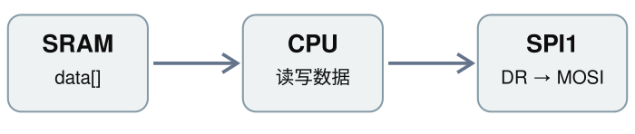

DMA搬运执行逻辑：
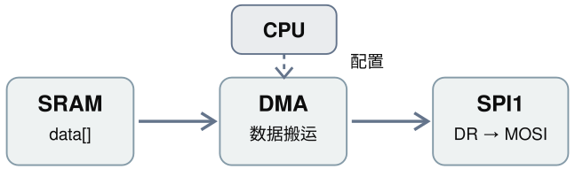


## **二、DMA 的工作原理**
### 2.1 DMA 传输需要确定什么？

- **从哪里读取数据**：源地址（Source Address）。
    
- **把数据写到哪里**：目标地址（Destination Address）。
    
- **搬运多少数据**：传输数量（Data Length）。
    
- **什么时候执行搬运**：传输触发条件（DMA Request）。

此外，还需要配置数据宽度、地址是否递增、工作模式等。

以SPI发送为例：
```c
uint8_t data[4] = {0x11, 0x22, 0x33, 0x44};
```
**源地址：**&data[0]
**目标地址：**&SPI1->DR  */%%/SPI 数据寄存器(SPI_DR)，数据寄存器对应两个缓冲区：一个用于写(发送缓冲)；另外一个用于读(接收缓冲)。写操作将数据写到发送缓冲区；读操作将返回接收缓冲区里的数据。%%*
**传输数量**：4
**触发条件**：SPI1_TX DMA Request

### 2.2 DMA Request 是怎样产生的？

SPI 内部**状态寄存器(SPI_SR)** 有一个重要标志：
`TXE`（Transmit Buffer Empty）：发送缓冲区空标志。*%%//0：发送缓冲非空；1：发送缓冲为空。%%*
当 SPI 发送缓冲区为空时，`TXE = 1`。
如果已经启用 SPI 的 TX DMA 请求功能，SPI 就能向 DMA 控制器提出传输请求。

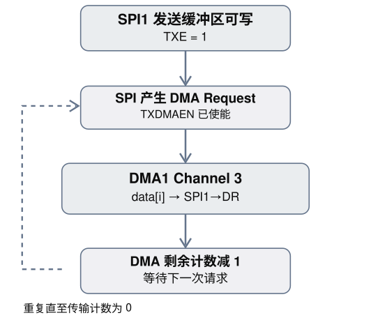
*%%//SPI 负责提出数据需求；DMA 在获得请求后完成一次数据搬运。图中省略了总线仲裁和具体硬件时序。%%*


## 三、STM32F103 的 DMA 硬件结构与配置
### 3.1 DMA 控制器和 Channel

STM32F103C8T6 的 DMA1，包含 7 个 DMA Channel。Channel 可以理解为 DMA 控制器中相对独立的传输通道，分别具有自己的配置和状态。
STM32F103 的 DMA 请求映射主要是**固定**的，但在较新的系列中有灵活 DMAMUX 请求映射能力。


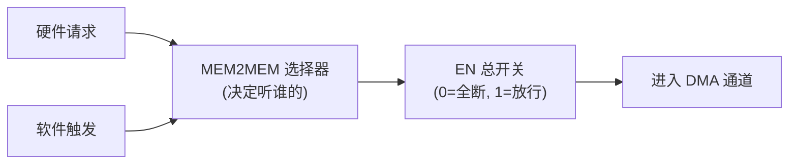

| DMA通道x配置寄存器(DMA_CCRx) |                                                                                                         |
| --------------------- | ------------------------------------------------------------------------------------------------------- |
| 位0                    | EN：通道开启 (Channel enable)该位由软件设置和清除。<br>0：通道不工作<br>1：通道开启                                                |
| 位14                   | MEM2MEM：存储器到存储器模式 (Memory to memory mode)该位**由软件设置和清除**。<br>0：正常外设模式 / 硬件触发；<br>1：存储器到存储器模式 / 软件触发。<br> |
*%%**`MEM2MEM = 0`：** 开关接通上方的 **“硬件请求”**。DMA 必须被动等待左侧的外设（如 `ADC1` 转换完成、`USART1_RX` 收到字节）发出脉冲信号，每收到一次硬件请求，才搬运一个数据。*

***`MEM2MEM = 1`：** 开关断开左侧所有外设的硬件请求，直接接通下方的 **“软件触发 (MEM2MEM 位)”**。因为 Flash 或 SRAM（存储器）不像 ADC/串口那样有专门的“数据就绪”硬件信号线，一旦开启该模式，只要软件把 **“通道的 EN 位”** 置 `1`，DMA 就会立即全速连续搬运数据，不需要等任何外设触发，直到传输计数器（`CNDTR`）减到 `0` 为止。%%*

### 3.2 DMA 的三个传输方向

| 方向                   | 含义      | 应用实例           |
| -------------------- | ------- | -------------- |
| Peripheral to Memory | 外设 → 内存 | ADC 采样、UART 接收 |
| Memory to Peripheral | 内存 → 外设 | SPI 发送、UART 发送 |
| Memory to Memory     | 内存 → 内存 | 数据块复制          |
需要注意：内存到内存模式可以由软件启动搬运；SPI、UART 等外设传输通常需要对应外设提供 DMA 请求。

### 3.3 DMA 配置参数的含义

| 参数                          | SPI1 TX 配置                 | 作用                               |
| --------------------------- | -------------------------- | -------------------------------- |
| ***Direction***             | ***Memory To Peripheral*** | ***内存向 SPI 发送数据***               |
| ***Mode***                  | ***Normal/Circular***      | ***发送指定数量后结束/一轮传输后自动装载传输数量及地址*** |
| ***Peripheral Increment***  | ***Disable***              | ***SPI 数据寄存器地址固定***              |
| ***Memory Increment***      | ***Enable***               | ***依次读取数组元素***                   |
| ***Peripheral Data Width*** | ***Byte***                 | ***每次向 SPI 写入 8 bit***           |
| ***Memory Data Width***     | ***Byte***                 | ***每次读取一个 8-bit 元素***            |
| ***Priority***              | ***Low / Medium***         | ***DMA 通道之间的仲裁优先级***             |

Memory Data Width 为 Byte，并且 Memory Increment  Address开启，那么 DMA 每完成一次数据搬运，下一次就访问下一个字节地址。
如果数据宽度设置为 Half Word（16 bit），地址递增步长则相应变成 2 字节。

### 3.4 Normal 与 Circular 的区别
**Normal 模式**                                                     **Circular 模式**
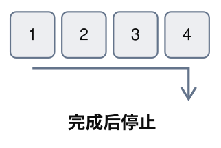 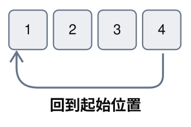
Normal 模式下，传输计数减为 0 后本次 DMA 传输结束。想继续搬运数据，需要软件重新配置或启动传输。
Circular 模式下（**CIRC=1**），传输数量及内部使用的地址位置会在**完成一轮后自动重新装载**，随后可以继续响应传输请求。所以 Circular 并不代表 DMA 无条件、无限速地搬运数据。它**仍然需要相应的传输触发条件**。

### 3.5 DMA Priority
![[DMA Settings_Priority.excalidraw|842]]
**DMA Priority** 决定多个 DMA 通道同时请求访问资源时，DMA 控制器优先服务哪个通道。


## 四、DMA 相关寄存器及其作用
### 4.1 DMA Channel 核心寄存器

| 寄存器                | 主要作用                                  |
| ------------------ | ------------------------------------- |
| ***`DMA_CCRx`***   | 通道使能、传输方向、地址递增、数据宽度、模式、优先级、中断使能 |
| ***`DMA_CNDTRx`*** | 剩余传输数据项数量                       |
| ***`DMA_CPARx`***  | 外设地址                            |
| ***`DMA_CMARx`***  | 内存地址                            |
| ***`DMA_ISR`***    | 读取 DMA 中断及状态标志                  |
| ***`DMA_IFCR`***   | 清除 DMA 对应标志                     |
> [!info]- `DMA_CCRx` — DMA 通道 x 配置寄存器
> 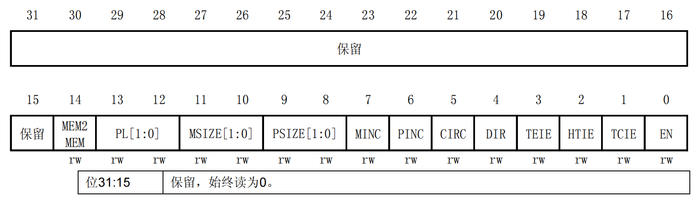
>
> | 位域 | 控制位 | 核心功能与取值 |
> | :--- | :--- | :--- |
> | `14` | **MEM2MEM** | 内存到内存：`0` 禁止 · `1` 启用 |
> | `13:12` | **PL[1:0]** | 通道优先级：`00` 低 · `01` 中 · `10` 高 · `11` 最高 |
> | `11:8` | **MSIZE / PSIZE** | 存储器 / 外设宽度：`00` 8位 · `01` 16位 · `10` 32位 |
> | `7:6` | **MINC / PINC** | 存储器 / 外设递增：`0` 固定 · `1` 递增 |
> | `5` | **CIRC** | 循环模式：`0` 单次 · `1` 循环 |
> | `4` | **DIR** | 传输方向：`0` 外设 → 内存 · `1` 内存 → 外设 |
> | `3:1` | **TEIE / HTIE / TCIE** | 错误 / 半传输 / 完成中断：`1` 使能 |
> | `0` | **EN** | 通道使能：`0` 关闭 · `1` 开启 |

> [!info]- `DMA_CNDTRx` — DMA 通道 x 传输数量寄存器 
> *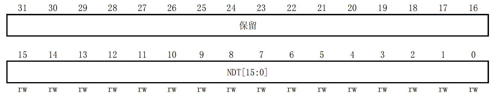*
> - **NDT[15:0]** (位 15:0): 剩余待传输数据项数量 (范围 `0 ~ 65535`)
>   - **写入限制**: 只能在通道关闭 (`DMA_CCRx` 的 `EN = 0`) 时写入。
>   - **硬件自减**: 每次数据传输后自动递减；若开启循环模式 (`CIRC = 1`)，减到 `0` 后自动重载初始值。

```c
uint8_t data[4] = {1, 2, 3, 4};
```

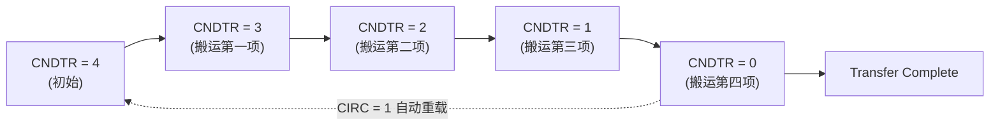
在 Normal 模式下，传输结束后可以产生 TC（Transfer Complete）标志。
*%%注意：==🟡**DMA 完成**表示已经完成了指定数量的总线数据搬运；**SPI 完成**则要求最后的数据已经通过 SPI 移位寄存器实际发送完毕。二者并不是同一时刻。%%*==

> [!info]- `DMA_CPARx` — DMA 通道 x 外设地址寄存器
> 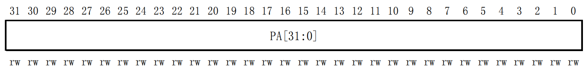
>
> | 位域 | 控制位 | 核心功能与限制 |
> | :--- | :--- | :--- |
> | `31:0` | **PA[31:0]** | 外设数据寄存器基地址：仅在 `EN = 0` 时可写（通道开启后只读）；按 `PSIZE` 宽度自动对齐 |

> [!info]- `DMA_CMARx` — DMA 通道 x 存储器地址寄存器
> 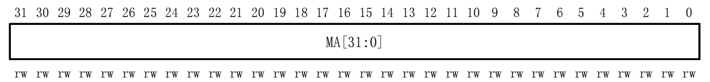
>
> | 位域 | 控制位 | 核心功能与限制 |
> | :--- | :--- | :--- |
> | `31:0` | **MA[31:0]** | 存储器缓冲区基地址：仅在 `EN = 0` 时可写（通道开启后只读）；按 `MSIZE` 宽度自动对齐 |

> [!info]- `DMA_ISR` — DMA 中断状态寄存器
> 
>
> | 位域 | 控制位 | 核心功能与取值 |
> | :--- | :--- | :--- |
> | `27, 23, 19, 15, 11, 7, 3` | **TEIFx** | 通道 x 传输错误标志：`0` 无错误 · `1` 发生错误 |
> | `26, 22, 18, 14, 10, 6, 2` | **HTIFx** | 通道 x 半传输标志：`0` 无事件 · `1` 产生半传输事件 |
> | `25, 21, 17, 13, 9, 5, 1` | **TCIFx** | 通道 x 传输完成标志：`0` 无事件 · `1` 产生传输完成事件 |
> | `24, 20, 16, 12, 8, 4, 0` | **GIFx** | 通道 x 全局中断标志：`1` 发生 TE / HT / TC 任一事件 |
>
> *注：所有标志位均为硬件置 `1`（只读），需向 `DMA_IFCR` 对应位写 `1` 清除。*

> [!info]- `DMA_IFCR` — DMA 中断标志清除寄存器
> 
>
> | 位域 | 控制位 | 核心功能与取值 |
> | :--- | :--- | :--- |
> | `27, 23, 19, 15, 11, 7, 3` | **CTEIFx** | 清除通道 x 传输错误标志：`0` 无效 · `1` 清除 `TEIFx` |
> | `26, 22, 18, 14, 10, 6, 2` | **CHTIFx** | 清除通道 x 半传输标志：`0` 无效 · `1` 清除 `HTIFx` |
> | `25, 21, 17, 13, 9, 5, 1` | **CTCIFx** | 清除通道 x 传输完成标志：`0` 无效 · `1` 清除 `TCIFx` |
> | `24, 20, 16, 12, 8, 4, 0` | **CGIFx** | 清除通道 x 全局中断标志：`1` 一次性清除该通道全部 4 个标志 |


## 五、结合 HAL 与寄存器理解 SPI DMA 的完整执行过程

以 **STM32F103C8T6、SPI1 主机、8 位数据、DMA Normal 模式、关闭 CRC** 为例，发送下面的数组：

```c
static uint8_t data[4] = {0x11, 0x22, 0x33, 0x44};

HAL_SPI_Transmit_DMA(&hspi1, data, 4);
```

### 5.1 初始化：配置 SPI、DMA，并建立句柄关联

在 CubeMX 工程中，通常可以看到：

```c
MX_GPIO_Init();
MX_DMA_Init();
MX_SPI1_Init();
```

这些 `MX_...` 函数是 CubeMX 生成的工程初始化函数，内部再调用 HAL 函数或宏。其中，**DMA 时钟必须在访问 DMA 寄存器之前开启**。相关配置通常分布在 `MX_DMA_Init()` 和 `HAL_SPI_MspInit()` 中。[ST HAL 使用说明](https://www.st.com/resource/en/user_manual/um1850-description-of-stm32f1-hal-and-lowlayer-drivers-stmicroelectronics.pdf)

#### 5.1.1开启 DMA 时钟，配置 DMA 中断

`MX_DMA_Init()` 中的相关内容通常类似：

```c
__HAL_RCC_DMA1_CLK_ENABLE();

HAL_NVIC_SetPriority(DMA1_Channel3_IRQn, 1, 0);
HAL_NVIC_EnableIRQ(DMA1_Channel3_IRQn);
```

本例使用 **DMA1 Channel 3**，因为 STM32F103 的 `SPI1_TX` 请求固定连接到该通道。中断优先级数值只是示例，应结合工程设置。[RM0008，DMA 请求映射](https://www.st.com/resource/en/reference_manual/rm0008-stm32f101xx-stm32f102xx-stm32f103xx-stm32f105xx-and-stm32f107xx-advanced-armbased-32bit-mcus-stmicroelectronics.pdf)

#### 5.1.2配置 DMA 的搬运规则

`HAL_SPI_Init(&hspi1)` 首次初始化 SPI 时，会调用底层初始化函数 `HAL_SPI_MspInit()`。其中除了 SPI 时钟、GPIO 配置，还可以包含下面的 DMA 配置：

```c
// HAL_SPI_MspInit() 中 SPI1 分支的 DMA 相关部分
hdma_spi1_tx.Instance = DMA1_Channel3;
hdma_spi1_tx.Init.Direction = DMA_MEMORY_TO_PERIPH;
hdma_spi1_tx.Init.PeriphInc = DMA_PINC_DISABLE;
hdma_spi1_tx.Init.MemInc = DMA_MINC_ENABLE;
hdma_spi1_tx.Init.PeriphDataAlignment = DMA_PDATAALIGN_BYTE;
hdma_spi1_tx.Init.MemDataAlignment = DMA_MDATAALIGN_BYTE;
hdma_spi1_tx.Init.Mode = DMA_NORMAL;
hdma_spi1_tx.Init.Priority = DMA_PRIORITY_MEDIUM;

if (HAL_DMA_Init(&hdma_spi1_tx) != HAL_OK)
{
    Error_Handler();
}

__HAL_LINKDMA(hspi, hdmatx, hdma_spi1_tx);
```

这里的 `hspi` 是 `HAL_SPI_MspInit()` 的参数，指向正在初始化的 SPI 句柄。

`hdma_spi1_tx.Init` 是内存中的配置结构体。调用 `HAL_DMA_Init()`，才会把相应参数写入 DMA 通道的 `CCR` 寄存器。[HAL DMA 初始化实现](https://github.com/STMicroelectronics/stm32f1xx-hal-driver/blob/master/Src/stm32f1xx_hal_dma.c)

| HAL 配置                 | 对应 `CCR` 位域              | 本例作用                 |
| ---------------------- | ------------------------ | -------------------- |
| `DMA_MEMORY_TO_PERIPH` | `DIR = 1`、使用外设请求模式 | 从内存搬向外设        |
| `DMA_PINC_DISABLE`     | `PINC = 0`         | 外设地址固定         |
| `DMA_MINC_ENABLE`      | `MINC = 1`         | 内存当前地址递增       |
| `DMA_PDATAALIGN_BYTE`  | `PSIZE = 00`       | 每次向外设写入 1 字节   |
| `DMA_MDATAALIGN_BYTE`  | `MSIZE = 00`       | 每次从内存读取 1 字节   |
| `DMA_NORMAL`           | `CIRC = 0`         | 完成指定数量后结束      |
| `DMA_PRIORITY_MEDIUM`  | `PL = 01`          | 设置 DMA 通道仲裁优先级 |

#### 5.1.3建立 SPI 句柄与 DMA 句柄之间的关联

```c
__HAL_LINKDMA(hspi, hdmatx, hdma_spi1_tx);

//可以理解为执行了：
hspi->hdmatx = &hdma_spi1_tx;
hdma_spi1_tx.Parent = hspi;

//它会让 SPI 句柄能够找到对应的 TX DMA 句柄，同时让 DMA 句柄能够找到所属的 SPI 句柄。
```

### 5.2 发起发送：HAL 先记录本次任务

应用调用：

```c
HAL_StatusTypeDef status;

status = HAL_SPI_Transmit_DMA(&hspi1, data, 4);

if (status != HAL_OK)
{
    // 本次启动未成功，进入应用自己的错误处理
    Error_Handler();
}
```

- `&hspi1`：使用哪一个 SPI。
- `data`：发送缓冲区的起始地址。
- `4`：发送的数据项数量；本例每项为 8 位。

这是非阻塞接口，启动后 CPU 可以继续执行其他任务。`HAL_OK` 表示启动成功，不能用来判断发送已经完成。[HAL SPI API 说明](https://www.st.com/resource/en/user_manual/um1850-description-of-stm32f1-hal-and-lowlayer-drivers-stmicroelectronics.pdf)

HAL 首先检查 SPI 是否处于可用状态，以及指针、数量是否有效，然后记录本次发送信息：

|SPI 句柄字段|本例含义|
|---|---|
|`State`|标记为 `BUSY_TX`|
|`pTxBuffPtr`|保存 `data` 的地址|
|`TxXferSize`|保存本次总数量 `4`|
|`TxXferCount`|初始化为 `4`|

这些字段位于 RAM 中，属于 HAL 的软件管理信息。**硬件实际剩余搬运数量要看 DMA 的 `CNDTR`；不能把软件字段当作 DMA 寄存器。**[SPI 句柄定义](https://github.com/STMicroelectronics/stm32f1xx-hal-driver/blob/master/Inc/stm32f1xx_hal_spi.h)

HAL 还会设置 DMA 的完成、半完成和错误处理函数，为后续中断处理建立入口。[HAL SPI 启动实现](https://github.com/STMicroelectronics/stm32f1xx-hal-driver/blob/master/Src/stm32f1xx_hal_spi.c)

### 5.3 启动 DMA：把本次地址和数量写入寄存器

接下来，SPI HAL 内部调用的核心接口相当于：

```c
HAL_DMA_Start_IT(
    hspi1.hdmatx,
    (uint32_t)data,
    (uint32_t)&SPI1->DR,
    4
);
```

应用使用 `HAL_SPI_Transmit_DMA()` 时，这一步由 SPI HAL 完成。

`HAL_DMA_Start_IT()` 在 DMA 软件状态允许启动时，关闭通道、清除旧标志、设置地址与数量、使能所需中断，再开启通道。[HAL DMA 启动实现](https://github.com/STMicroelectronics/stm32f1xx-hal-driver/blob/master/Src/stm32f1xx_hal_dma.c)

对应到本例：

| 操作     | 寄存器变化                        | 原因             |
| ------ | ---------------------------- | -------------- |
| 关闭通道   | `CCR.EN = 0`                 | 允许配置本次传输       |
| 清除旧标志  | 向 `IFCR` 对应位写 `1`            | 清除上次遗留事件       |
| 设置目标   | `CPAR = &SPI1->DR`           | 每次写入 SPI 数据寄存器 |
| 设置源    | `CMAR = &data[0]`            | 从数组起始位置读取      |
| 设置数量   | `CNDTR = 4`                  | 搬运 4 个数据项      |
| 配置事件中断 | 设置 `TCIE`、`TEIE`，按需设置 `HTIE` | 处理完成、错误、半完成    |
| 开启通道   | `CCR.EN = 1`                 | 允许通道响应请求       |

这些使能位和清除标志宏最终都作用于 **DMA 寄存器**。**此时 DMA 已经准备好，但还需要 SPI 提供请求。**

### 5.4 打开 SPI 请求：让硬件传输开始推进

DMA 启动成功后，SPI HAL 按需设置：

```c
// SPI 未开启时，使能 SPI
__HAL_SPI_ENABLE(&hspi1);

// 允许 SPI 产生发送 DMA 请求
SET_BIT(hspi1.Instance->CR2, SPI_CR2_TXDMAEN);
```

对应两个寄存器位：

|寄存器位|作用|
|---|---|
|`SPI_CR1.SPE`|使能 SPI|
|`SPI_CR2.TXDMAEN`|允许 SPI 发出 TX DMA 请求|

`HAL_SPI_Transmit_DMA()` 随后返回。硬件可以在 `TXDMAEN` 开启、请求条件满足后立即工作，无需等待函数返回。[HAL SPI 启动顺序](https://github.com/STMicroelectronics/stm32f1xx-hal-driver/blob/master/Src/stm32f1xx_hal_spi.c)

软件启动过程如下，图中省略错误处理和 CRC 等分支：
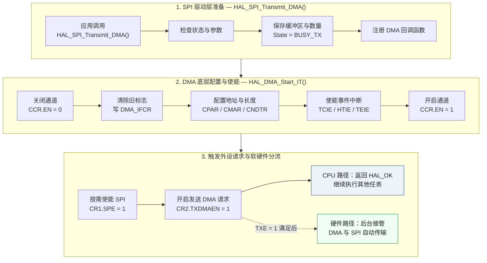
### 5.5 硬件执行：SPI 提请求，DMA 搬一项

进入硬件传输阶段后，关键是 `SPI_SR.TXE`：

- `TXE = 1`：发送缓冲区为空，可以接收下一项。
- `TXE = 0`：发送缓冲区非空，暂时不能再写。

`TXDMAEN = 1` 允许 SPI 根据发送缓冲区的状态提出 DMA 请求。

以第一次搬运为例，DMA 响应请求并获得总线访问后：

1. 从内存当前地址读取 `data[0]`，得到 `0x11`。
2. 将 `0x11` 写入 `SPI1->DR`。
3. 内存内部当前地址递增 1 字节。
4. `CNDTR` 从 `4` 减为 `3`。

写入 DR 后，发送缓冲区非空，`TXE` 清零。SPI 随后把缓冲区数据装入移位寄存器，并按 SCK 节拍发送；缓冲区腾空后，`TXE` 再次置位，推动下一次请求。[RM0008，DMA 与 SPI 发送过程](https://www.st.com/resource/en/reference_manual/rm0008-stm32f101xx-stm32f102xx-stm32f103xx-stm32f105xx-and-stm32f107xx-advanced-armbased-32bit-mcus-stmicroelectronics.pdf)

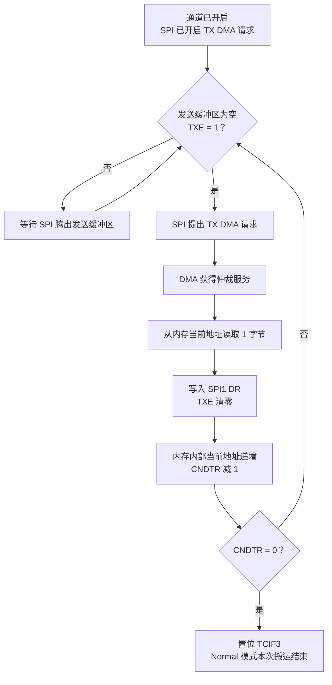

|搬运次数|读取数据|写入目标|搬运后的 `CNDTR`|
|---|---|---|---|
|1|`data[0] = 0x11`|`SPI1->DR`|`3`|
|2|`data[1] = 0x22`|`SPI1->DR`|`2`|
|3|`data[2] = 0x33`|`SPI1->DR`|`1`|
|4|`data[3] = 0x44`|`SPI1->DR`|`0`|

这里递增的是 DMA **内部当前地址**，配置的 `CMAR` 仍保留起始地址。

同时，**`TXE = 1` 不代表上一字节已经发完**：上一字节可以仍在移位寄存器中发送，而 DMA 已经向腾空的发送缓冲区填入下一字节。[RM0008，DMA 地址与 SPI 缓冲机制](https://www.st.com/resource/en/reference_manual/rm0008-stm32f101xx-stm32f102xx-stm32f103xx-stm32f105xx-and-stm32f107xx-advanced-armbased-32bit-mcus-stmicroelectronics.pdf)

### 5.6 完成处理：从 DMA 中断进入 SPI HAL 回调

最后一项写入 DR 后，`CNDTR = 0`，DMA 将 `ISR.TCIF3` 置位。满足中断使能条件时，CPU 进入：

```c
void DMA1_Channel3_IRQHandler(void)
{
    HAL_DMA_IRQHandler(&hdma_spi1_tx);
}
```

**这个中断入口必须调用对应 DMA 句柄的 HAL 处理函数，完成事件才能沿 HAL 回调链继续处理。**[HAL DMA 中断用法](https://www.st.com/resource/en/user_manual/um1850-description-of-stm32f1-hal-and-lowlayer-drivers-stmicroelectronics.pdf)

`HAL_DMA_IRQHandler()` 读取状态、通过 `IFCR` 清除完成标志，并调用此前安装的完成回调。

对于 SPI TX，这个内部回调是：

```c
SPI_DMATransmitCplt()
```

该函数通过 DMA 句柄的 `Parent` 找回 SPI 句柄。在本例 Normal 模式下，它关闭 TX DMA 请求，并检查：

1. `TXE = 1`：发送缓冲区已经腾空。
2. `BSY = 0`：SPI 已经完成线路上的发送。

检查成功后，恢复 SPI 软件状态，并通知用户。[HAL SPI 完成处理实现](https://github.com/STMicroelectronics/stm32f1xx-hal-driver/blob/master/Src/stm32f1xx_hal_spi.c)
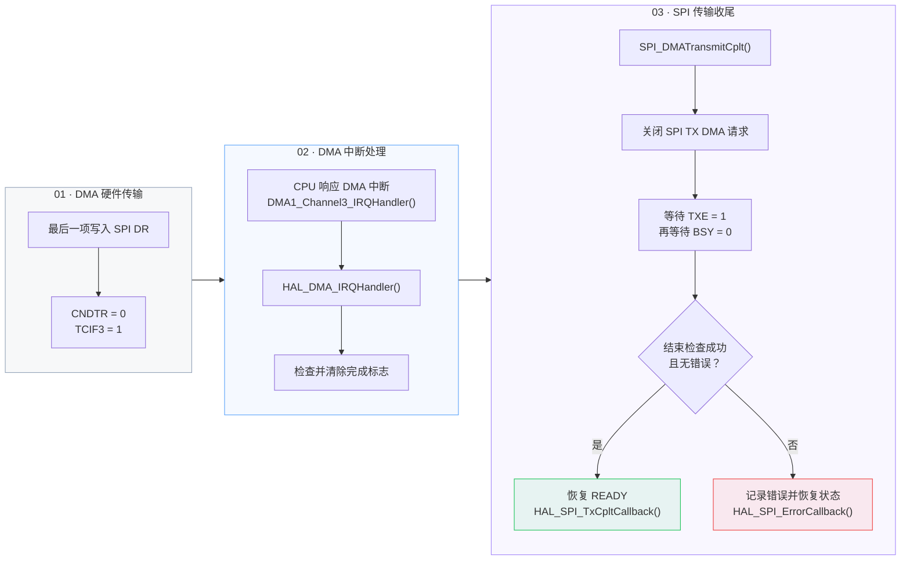

因此，需要区分两个时刻：

| 时刻                                 | 表示什么               |
| ---------------------------------- | ------------------ |
| DMA 的 `TCIF3` 置位                   | 最后一项已经搬进 SPI       |
| 本例的 `HAL_SPI_TxCpltCallback()` 被调用 | HAL 已确认 SPI 正常发送结束 |

### 5.7 应用使用回调获知结果

采用默认的弱函数回调机制时，应用可以实现：

```c
static volatile uint8_t spi1_tx_done = 0;
static volatile uint8_t spi1_tx_failed = 0;

void HAL_SPI_TxCpltCallback(SPI_HandleTypeDef *hspi)
{
    if (hspi->Instance == SPI1)
    {
        spi1_tx_done = 1;
    }
}

void HAL_SPI_ErrorCallback(SPI_HandleTypeDef *hspi)
{
    if (hspi->Instance == SPI1)
    {
        spi1_tx_failed = 1;
    }
}
```

发送前先清除应用标志，再发起本次任务：

```c
spi1_tx_done = 0;
spi1_tx_failed = 0;

HAL_StatusTypeDef status =
    HAL_SPI_Transmit_DMA(&hspi1, data, 4);

if (status != HAL_OK)
{
    // 启动失败，不能等待本次发送的完成回调
    Error_Handler();
}

// CPU 继续处理其他任务
// 后续根据 spi1_tx_done / spi1_tx_failed 处理结果
```

这些回调由中断处理路径调用，适合设置标志，把较长的业务处理留给主循环或任务。若工程启用了动态回调注册，应使用对应的注册接口。[HAL SPI 回调机制](https://github.com/STMicroelectronics/stm32f1xx-hal-driver/blob/master/Inc/stm32f1xx_hal_spi.h)

发送缓冲区必须在整个传输期间保持有效；在应用获知完成之前，不要覆盖其中的数据。HAL 保存缓冲区地址后，DMA 会在后续请求到来时逐项读取它。


## 六、DMA 中断与 HAL 回调的关系
### 6.1 为什么 DMA 完成后需要中断？
![[DMA-NVIC_Settings.excalidraw|842]]
#### 6.1.1 DMA 完成传输后还需要做什么？

在第五章中，我们已经知道，CPU 完成 DMA 的配置和启动后，DMA 就能够根据 SPI 外设产生的 DMA Request，自主完成数据搬运，而 CPU 可以继续执行其他程序。

假设现在要发送一个数组：
```c
uint8_t data[4] = {0x11, 0x22, 0x33, 0x44};

HAL_SPI_Transmit_DMA(&hspi1, data, 4);
```

在启动 DMA 之后，CPU、DMA、SPI 三者会并行工作。

当 DMA 将最后一个数据写入 SPI 数据寄存器后，本次 DMA 搬运任务就结束了。但是**对于整个应用程序而言，还有一些工作没有完成**：

- 确认 SPI 是否真正发送完毕。
    
- 关闭 SPI 的 TX DMA 请求功能。
    
- 将 HAL 库中的 SPI 状态恢复为 READY。
    
- 拉高 LCD 的 CS 片选引脚。
    
- 启动下一次 DMA 传输，或者通知正在等待的 FreeRTOS 任务。

但是这些工作不属于DMA 控制器的职责，需要由 CPU 执行。此时 CPU 正在执行其他程序，它并不知道 DMA 什么时候完成了数据搬运。**因此，我们需要建立一种机制，让 CPU 获知 DMA 的传输结果，并执行相应的后续处理。**

#### 6.1.2 CPU 如何知道 DMA 已经完成传输？

在第四章中已经介绍过 `DMA_CNDTR` 寄存器，该寄存器记录 DMA 剩余需要搬运的数据项数量。当 DMA 完成最后一次数据搬运时，硬件会将传输完成标志 TCIF（Transfer Complete Interrupt Flag）置 1。

*Normal 模式下，传输计数与完成标志之间的关系。*

此时，CPU 就可以通过 TCIF 标志位判断 DMA 是否已经完成搬运。但是**标志位置位并不意味着 CPU 会主动执行相应的处理程序。** 标志位只是硬件对事件发生情况的一种记录。
为了让 CPU 获知这个事件，有两种处理方式。

**方式一：轮询 DMA 完成标志**

CPU 主动读取 TCIF 标志位，如果该标志位为 0，则表示 DMA 尚未完成；如果为 1，则说明 DMA 已经完成传输。
```c
while ((DMA1->ISR & DMA_ISR_TCIF3) == 0)
{
    // 等待 DMA 完成
}

// 执行传输完成后的处理
```
这种方式虽然将数据搬运的工作交给了 DMA，但是 CPU 仍然需要不断查询 DMA 的状态，无法充分利用 DMA 带来的并行执行能力。当然，也可以在主循环中周期性查询标志位，而不是一直阻塞等待。

**方式二：使用 DMA 完成中断**

如果开启 DMA 的传输完成中断，**当 TCIF 置 1 时**，DMA 就会向 NVIC 提出**中断请求**。CPU 不需要主动查询 DMA 的状态，而是继续执行其他程序。当 CPU 响应该中断时，再执行与 DMA 传输完成相关的处理程序。

### 6.2 DMA 中断的产生机制

DMA在什么情况下产生中断，中断请求又是如何传递给CPU的？

#### 6.2.1 DMA 的中断类型

除了传输完成以外，DMA 还存在其他需要 CPU 处理的事件。STM32F103 的每个 DMA 通道都支持以下三种中断事件：

| 中断事件                  | 状态标志位 | 中断使能位 |
| --------------------- | ----- | ----- |
| HT（Half Transfer）     | HTIF  | HTIE  |
| TC（Transfer Complete） | TCIF  | TCIE  |
| TE（Transfer Error）    | TEIF  | TEIE  |
其中，状态标志位位于 `DMA_ISR` 寄存器中，中断使能位位于对应通道的 `DMA_CCRx` 寄存器中。

- **HT：传输半完成。** 可以提前处理已经搬运完成的部分数据。
    
- **TC：传输完成。** 可以处理本次传输结果，或者启动下一次传输。
    
- **TE：传输错误。** 通知 CPU 处理 DMA 搬运过程中出现的错误。

假设现在 DMA 需要搬运 8 个数据：

在传输过程中，DMA 可以分别产生半完成事件和完成事件。如果对应的中断已经使能，就可以通知 CPU 处理这些事件。
半完成中断在 ADC 连续采样、音频数据采集等场景中比较常见，CPU 可以处理缓冲区的前半部分，而 DMA 继续填充后半部分。

#### 6.2.2 中断标志位与中断使能位的关系

以 SPI1_TX 对应的 DMA1 Channel 3 为例：
```c
DMA1->ISR              // 包含 TCIF3
DMA1_Channel3->CCR     // 包含 TCIE
```
- `TCIF3`：记录传输完成事件是否已经发生。
    
- `TCIE`：决定是否允许该事件产生中断请求。

两者之间的关系可以用一个与门表示。


| TCIF3 | TCIE | 是否产生 TC 中断请求 |
| :---: | :--: | :----------: |
|   0   |  0   |      否       |
|   0   |  1   |      否       |
|   1   |  0   |      否       |
|   1   |  1   |      是       |

#### 6.2.3 DMA 中断请求如何传递给 CPU？

在 DMA 产生中断请求后，还需要经过 NVIC，CPU 才能进入相应的中断服务函数。

因此，要让 CPU 正常响应 DMA 完成中断，除了 DMA 内部的 TCIE 使能以外，还需要使能 NVIC 中对应的中断通道。

CubeMX 通常会生成以下代码：

```c
HAL_NVIC_SetPriority(DMA1_Channel3_IRQn, 5, 0);
HAL_NVIC_EnableIRQ(DMA1_Channel3_IRQn);
```

而 DMA 内部的完成中断使能，通常由 `HAL_DMA_Start_IT()` 在启动传输时完成。

### 6.3 DMA 完成与 SPI 完成的区别

在继续讲解 HAL 中断处理流程之前，需要先解决一个问题：

**既然 DMA 已经产生了传输完成中断，为什么 HAL 不能直接通知用户 SPI 发送完成？**

这是因为 DMA 和 SPI 是两个相对独立的硬件模块，它们所负责的工作不同。

#### 6.3.1 SPI 内部的数据传输过程

回顾 SPI 的内部结构，SPI 发送数据时主要涉及两个部分：

- 发送缓冲区（Transmit Buffer）：暂存即将发送的数据，通过 SPI_DR 访问。

- 移位寄存器（Shift Register）：按照 SPI 时钟将数据逐位发送出去。

***DMA 的职责到将数据写入 SPI_DR 为止，之后的数据转移和逐位发送都由 SPI 硬件完成。所以 DMA 搬运完成时，SPI 内部可能仍然存在尚未发出的数据。***

#### 6.3.2 TXE 与 BSY 标志位

为了判断 SPI 内部的数据是否已经全部发送完毕，需要使用 SPI_SR 寄存器中的两个状态标志。

|标志位|全称|含义|
|---|---|---|
|TXE|Transmit Buffer Empty|发送缓冲区为空|
|BSY|Busy Flag|SPI 是否处于忙状态|

由于发送缓冲区中的数据需要转移到移位寄存器，因此 TXE = 1 时，SPI 仍然可能正在发送数据。


阶段一中，DMA 已经将最后一个字节写入发送缓冲区，但 SPI 仍在发送前一个字节。阶段二中，发送缓冲区虽然为空，最后一个字节却仍在通过 MOSI 输出。只有到了阶段三，SPI 才退出忙状态。

总结以上三个阶段：

|阶段|CNDTR|TXE|BSY|
|---|---|---|---|
|DMA 完成最后一次搬运|0|0|1|
|最后一个数据进入移位寄存器|0|1|1|
|SPI 完成全部数据发送|0|1|0|

因此，在 STM32F103 的 SPI 主机发送场景下，DMA 搬运完成之后，还需要确认 TXE = 1、BSY = 0，才能正常结束本次 SPI 发送事务。这也决定了接下来 HAL 库的中断处理流程为什么需要分为 DMA 层和 SPI 层。

### 6.4 DMA 中断与 HAL 回调函数的关系

#### 6.4.1 为什么需要多层回调函数？

DMA 是一个通用的数据搬运外设，它不仅可以服务于 SPI，还可以服务于 UART、ADC、I2C 等外设。

然而，不同外设在 DMA 完成搬运后，需要执行的后续处理并不相同。

不同外设需要不同的传输完成处理逻辑。

如果将所有外设的处理逻辑都写在 DMA 中断处理函数中，就会导致 DMA 驱动与其他外设驱动高度耦合。

因此，HAL 库采用了函数指针和回调机制，将处理过程划分为三个层次：

|层次|职责|
|---|---|
|DMA 驱动层|处理 DMA 硬件事件|
|外设驱动层|处理 SPI、UART、ADC 等外设特有的工作|
|用户应用层|处理具体的业务逻辑|

每一层只完成自身职责，然后调用下一层对应的处理函数。

#### 6.4.2 HAL 如何建立 DMA 层与 SPI 层的关系？

回顾第五章，在调用 `HAL_SPI_Transmit_DMA()` 时，HAL 会配置 DMA 的回调函数。

其中包括：

```c
hspi->hdmatx->XferHalfCpltCallback = SPI_DMAHalfTransmitCplt;

hspi->hdmatx->XferCpltCallback = SPI_DMATransmitCplt;

hspi->hdmatx->XferErrorCallback = SPI_DMAError;
```

这里的 `XferCpltCallback` 是 DMA 句柄中的一个函数指针成员。

上述赋值操作并不是在调用 `SPI_DMATransmitCplt()`，而是在保存该函数的地址，告诉 DMA 驱动：当本次传输完成时，应当调用这个函数。


这样一来，DMA 驱动就不需要知道当前正在为哪个外设服务，只需要在对应事件发生时调用已经设置好的回调函数即可。

### 6.5 从 DMA 中断到用户回调的完整执行流程

当 DMA 完成数据搬运之后，CPU 将依次执行以下几个函数。


#### 6.5.1 DMA1_Channel3_IRQHandler()

`DMA1_Channel3_IRQHandler()`是 DMA1 Channel 3 对应的中断服务函数（ISR），也是 CPU 响应本次 **DMA 中断**后的**程序入口**。

CubeMX 通常会生成如下代码：

```c
void DMA1_Channel3_IRQHandler(void)
{
    HAL_DMA_IRQHandler(&hdma_spi1_tx);
}
```

由于 DMA1 Channel 3 具有 HT、TC、TE 三种中断事件，因此仅仅进入这个中断服务函数，并不能确定具体发生了哪一种事件。所以还需要调用 `HAL_DMA_IRQHandler()` 来进一步判断和处理。

#### 6.5.2 HAL_DMA_IRQHandler()

`HAL_DMA_IRQHandler()`是 HAL 库提供的通用 DMA 中断处理函数。它通过传入的 DMA 句柄找到对应的 DMA 通道，然后检查状态标志位和中断使能位，判断当前需要处理的事件。

如果本次需要处理的是 **Normal** 模式下的传输完成事件，那么它主要执行以下操作：

1. 关闭 DMA 的 TC、TE 中断使能。

2. 将 DMA 句柄的状态恢复为 READY。

3. 清除传输完成标志位。

4. 解除 DMA 句柄的软件锁。

5. 调用传输完成回调函数。

以下为关键代码的简化示意。

```c
void HAL_DMA_IRQHandler(DMA_HandleTypeDef *hdma)
{
    // 省略中断类型判断

    // 处理 Normal 模式下的 TC 事件
    hdma->State = HAL_DMA_STATE_READY;

    // 清除完成标志等收尾操作

    if (hdma->XferCpltCallback != NULL)
    {
        hdma->XferCpltCallback(hdma);
    }
}
```

由于在 DMA 启动之前，SPI HAL 已经将 `XferCpltCallback` 指向了 `SPI_DMATransmitCplt()`，所以最后一条函数指针调用实际进入的就是 SPI 层的内部完成处理函数。至此，DMA 层的主要工作已经完成。

#### 6.5.3 SPI_DMATransmitCplt()

该函数是 SPI HAL 内部使用的 DMA 发送完成回调函数。

首先需要理解它的参数：

```c
static void SPI_DMATransmitCplt(DMA_HandleTypeDef *hdma)
```

DMA 层传入的是 DMA 句柄，但当前函数需要操作 SPI 外设，因此必须先通过 DMA 句柄找到 SPI 句柄。

这就需要利用第五章介绍过的 `__HAL_LINKDMA()` 建立的关联关系。

SPI 句柄与 DMA 句柄之间建立了双向关联。


因此可以通过以下代码获得 SPI 句柄：

```c
SPI_HandleTypeDef *hspi =
    (SPI_HandleTypeDef *)hdma->Parent;
```

获得 SPI 句柄后，HAL 就可以操作 SPI 外设及其软件状态。

现在回顾 6.3 中讲到的知识：DMA 完成并不意味着 SPI 完成。

所以在 Normal 模式下，`SPI_DMATransmitCplt()` 主要负责：

1. 关闭 SPI 错误中断使能。

2. 清除 TXDMAEN，关闭 SPI TX DMA 请求。

3. 调用 `SPI_EndRxTxTransaction()`，等待 TXE = 1、BSY = 0，并处理超时错误。

4. 在双线通信模式下清除 OVR 标志。

5. 将 SPI 软件传输计数清零。

6. 将 SPI 软件状态恢复为 READY。

7. 根据错误状态，调用用户的完成回调或错误回调。


这里需要特别注意，DMA 的状态与 SPI 的状态是相互独立的：

```c
hdma_spi1_tx.State
hspi1.State
```

DMA 的状态由 DMA 层负责维护，而 SPI 的状态由 SPI 层负责维护。

所以 DMA 已经恢复 READY，并不意味着 SPI 也已经恢复 READY。

#### 6.5.4 HAL_SPI_TxCpltCallback()

前面的几个函数全部属于中断处理或驱动层的内部处理。

当 SPI HAL 确认发送正常结束、完成必要的收尾工作后，最后才调用用户回调函数：

```c
void HAL_SPI_TxCpltCallback(SPI_HandleTypeDef *hspi)
{

}
```

在默认的弱函数回调机制下，该函数由 HAL 库提供弱定义（`__weak`），用户可以在自己的代码文件中重新定义它，从而实现自定义的处理逻辑。

以之前的 LCD 项目为例：

```c
void HAL_SPI_TxCpltCallback(SPI_HandleTypeDef *hspi)
{
    if (hspi->Instance == SPI1)
    {
        HAL_GPIO_WritePin(
            LCD_CS_GPIO_Port,
            LCD_CS_Pin,
            GPIO_PIN_SET
        );
    }
}
```

由于进入该函数时，SPI HAL 已经确认本次 SPI 发送正常结束，因此可以安全地结束当前 LCD 片选事务（还需满足 LCD 自身的片选保持时间要求）。

除此之外，也可以在这个函数中启动下一块数据的 DMA 发送、释放二进制信号量或者发送 FreeRTOS 任务通知。

这些操作属于应用层的工作，不属于 DMA 驱动或 SPI 驱动本身的职责。

### 6.6 中断服务函数与回调函数的区别

在 HAL 库中经常遇到以下三类函数：

| 对比项           |            中断服务函数            |       HAL 中断处理函数       |            回调函数            |
| :------------ | :--------------------------: | :--------------------: | :------------------------: |
| 示例            | `DMA1_Channel3_IRQHandler()` | `HAL_DMA_IRQHandler()` | `HAL_SPI_TxCpltCallback()` |
| 调用者           |          CPU 异常响应机制          |         中断服务函数         |          HAL 内部函数          |
| 主要作用          |           进入中断处理流程           |       识别并处理硬件事件        |           处理特定事件           |
| 是否对应中断向量      |              是               |           否            |             否              |
| 是否属于普通 C 函数调用 |           不是普通调用进入           |           是            |             是              |

虽然 HAL 中断处理函数和回调函数并不是 CPU 直接进入的中断服务函数，但是它们都是在本次 ISR 的执行过程中被调用的。

因此，它们仍然处于中断上下文（Interrupt Context）中。


这也解释了为什么在 DMA 完成回调中使用 FreeRTOS API 时，需要使用带有 `FromISR` 后缀的版本。

例如：

常见接口包括 `xSemaphoreGiveFromISR()`、`xQueueSendFromISR()`、`vTaskNotifyGiveFromISR()`。这里列出的是 API 名称，实际调用时需要传入相应参数。

同时还需要满足 FreeRTOS 对可调用内核 API 的中断优先级限制。

不能因为函数名称中没有 `IRQHandler`，就认为它已经脱离中断上下文。

### 6.7 DMA Request 与 DMA Interrupt 的区别

现在可以结合整个执行过程，重新理解第二章提到的 DMA Request 和 DMA Interrupt。


|对比项|DMA Request|DMA Interrupt|
|---|---|---|
|信号产生方|外设|DMA 控制器|
|信号接收方|DMA 控制器|NVIC、CPU|
|主要作用|请求搬运数据|通知 DMA 相关事件|
|SPI 发送时的触发条件|TXE 与 TXDMAEN|DMA 事件标志与中断使能|
|是否需要 CPU 参与响应|否|是|
|发生频率|通常每个数据项对应一次搬运请求|由半完成、完成、错误等事件决定|

DMA Request 解决的是硬件之间的数据搬运问题，DMA Interrupt 解决的是硬件与软件之间的事件通知问题。


## 七、HAL 状态管理与异步传输机制

要正确使用 DMA，还需要理解 HAL 的状态管理机制，以及异步传输机制对程序执行流程的影响。

### 7.1 阻塞式传输与非阻塞式传输


