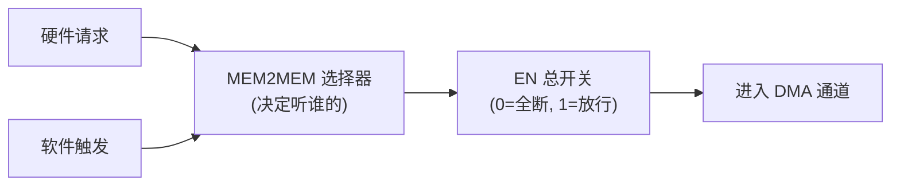
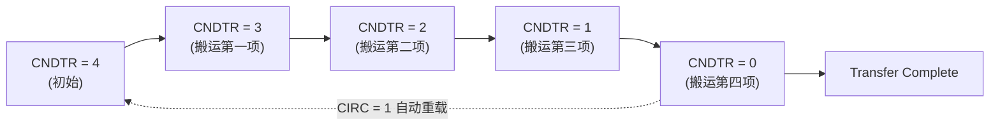
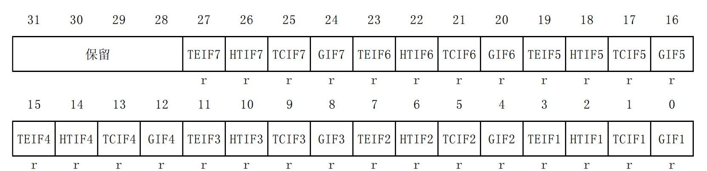
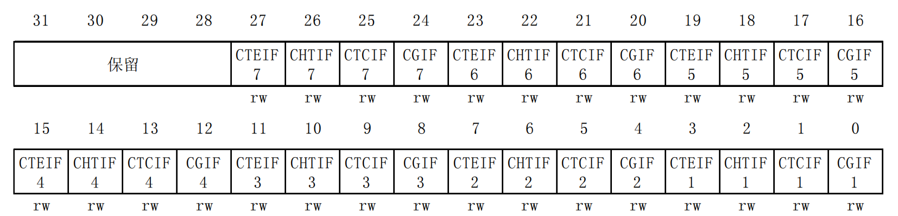
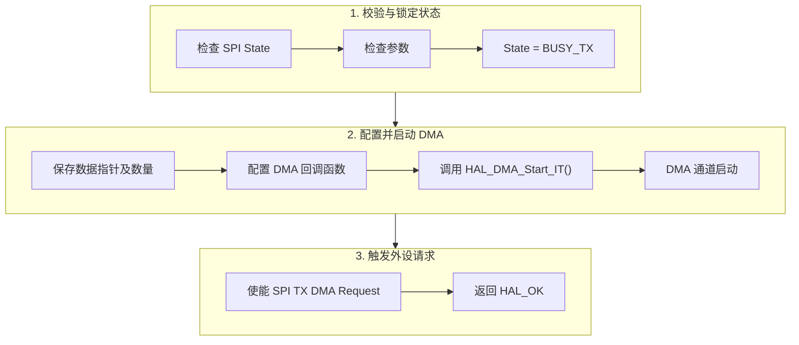
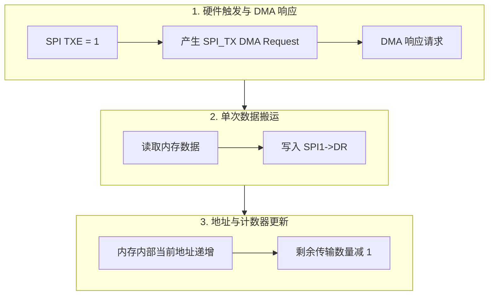

*%%//以STM32F103系列为例%%*
## 一、DMA 的基本概念：为什么需要 DMA？
### 1.1 DMA 是什么？

DMA（Direct Memory Access，直接存储器访问）是一种允许硬件在**不需要 CPU 逐个搬运数据**的情况下，完成数据传输的机制。

在**没有 DMA** 时，CPU 是怎样搬运数据的？
假设我们需要通过 SPI 向 LCD 发送一个数组

```c
uint8_t data[4] = {0x11, 0x22, 0x33, 0x44};

for (int i = 0; i < 4; i++)
{
    while ((SPI1->SR & SPI_SR_TXE) == 0)
    {
        // 等待发送数据寄存器可写
    }

    *((volatile uint8_t *)&SPI1->DR) = data[i];
}

// 最后还需要等待SPI传输真正结束
```
CPU搬运执行逻辑：
%22%20viewBox%3D%220%200%20340%2072%22%20width%3D%22100%25%22%20xmlns%3D%22http%3A%2F%2Fwww.w3.org%2F2000%2Fsvg%22%3E%3Crect%20x%3D%224%22%20y%3D%228%22%20width%3D%2275%22%20height%3D%2252%22%20rx%3D%227%22%20fill%3D%22%23859BA8%22%20fill-opacity%3D%22.13%22%20stroke%3D%22%23859BA8%22%2F%3E%3Ctext%20x%3D%2241.5%22%20y%3D%2228%22%20font-size%3D%2213%22%20font-weight%3D%22600%22%20text-anchor%3D%22middle%22%20fill%3D%22currentColor%22%3ESRAM%3C%2Ftext%3E%3Ctext%20x%3D%2241.5%22%20y%3D%2245%22%20font-size%3D%2210%22%20text-anchor%3D%22middle%22%20fill%3D%22currentColor%22%3Edata%5B%5D%3C%2Ftext%3E%3Crect%20x%3D%22130%22%20y%3D%228%22%20width%3D%2275%22%20height%3D%2252%22%20rx%3D%227%22%20fill%3D%22%23859BA8%22%20fill-opacity%3D%22.13%22%20stroke%3D%22%23859BA8%22%2F%3E%3Ctext%20x%3D%22167.5%22%20y%3D%2228%22%20font-size%3D%2213%22%20font-weight%3D%22600%22%20text-anchor%3D%22middle%22%20fill%3D%22currentColor%22%3ECPU%3C%2Ftext%3E%3Ctext%20x%3D%22167.5%22%20y%3D%2245%22%20font-size%3D%2210%22%20text-anchor%3D%22middle%22%20fill%3D%22currentColor%22%3E%E8%AF%BB%E5%86%99%E6%95%B0%E6%8D%AE%3C%2Ftext%3E%3Crect%20x%3D%22256%22%20y%3D%228%22%20width%3D%2280%22%20height%3D%2252%22%20rx%3D%227%22%20fill%3D%22%23859BA8%22%20fill-opacity%3D%22.13%22%20stroke%3D%22%23859BA8%22%2F%3E%3Ctext%20x%3D%22296%22%20y%3D%2228%22%20font-size%3D%2213%22%20font-weight%3D%22600%22%20text-anchor%3D%22middle%22%20fill%3D%22currentColor%22%3ESPI1%3C%2Ftext%3E%3Ctext%20x%3D%22296%22%20y%3D%2245%22%20font-size%3D%2210%22%20text-anchor%3D%22middle%22%20fill%3D%22currentColor%22%3EDR%20%E2%86%92%20MOSI%3C%2Ftext%3E%3Cpath%20d%3D%22M82%2034%20H126%20M208%2034%20H252%22%20stroke%3D%22%2364748b%22%20stroke-width%3D%221.8%22%20fill%3D%22none%22%2F%3E%3Cpath%20d%3D%22M119%2029%20L127%2034%20L119%2039%20M245%2029%20L253%2034%20L245%2039%22%20stroke%3D%22%2364748b%22%20stroke-width%3D%221.8%22%20fill%3D%22none%22%2F%3E%3C%2Fsvg%3E)

DMA搬运执行逻辑：
%22%20viewBox%3D%220%200%20340%20105%22%20width%3D%22100%25%22%20xmlns%3D%22http%3A%2F%2Fwww.w3.org%2F2000%2Fsvg%22%3E%3Crect%20x%3D%224%22%20y%3D%2246%22%20width%3D%2275%22%20height%3D%2252%22%20rx%3D%227%22%20fill%3D%22%23859BA8%22%20fill-opacity%3D%22.13%22%20stroke%3D%22%23859BA8%22%2F%3E%3Ctext%20x%3D%2241.5%22%20y%3D%2266%22%20font-size%3D%2213%22%20font-weight%3D%22600%22%20text-anchor%3D%22middle%22%20fill%3D%22currentColor%22%3ESRAM%3C%2Ftext%3E%3Ctext%20x%3D%2241.5%22%20y%3D%2283%22%20font-size%3D%2210%22%20text-anchor%3D%22middle%22%20fill%3D%22currentColor%22%3Edata%5B%5D%3C%2Ftext%3E%3Crect%20x%3D%22130%22%20y%3D%2246%22%20width%3D%2275%22%20height%3D%2252%22%20rx%3D%227%22%20fill%3D%22%23859BA8%22%20fill-opacity%3D%22.13%22%20stroke%3D%22%23859BA8%22%2F%3E%3Ctext%20x%3D%22167.5%22%20y%3D%2266%22%20font-size%3D%2213%22%20font-weight%3D%22600%22%20text-anchor%3D%22middle%22%20fill%3D%22currentColor%22%3EDMA%3C%2Ftext%3E%3Ctext%20x%3D%22167.5%22%20y%3D%2283%22%20font-size%3D%2210%22%20text-anchor%3D%22middle%22%20fill%3D%22currentColor%22%3E%E6%95%B0%E6%8D%AE%E6%90%AC%E8%BF%90%3C%2Ftext%3E%3Crect%20x%3D%22256%22%20y%3D%2246%22%20width%3D%2280%22%20height%3D%2252%22%20rx%3D%227%22%20fill%3D%22%23859BA8%22%20fill-opacity%3D%22.13%22%20stroke%3D%22%23859BA8%22%2F%3E%3Ctext%20x%3D%22296%22%20y%3D%2266%22%20font-size%3D%2213%22%20font-weight%3D%22600%22%20text-anchor%3D%22middle%22%20fill%3D%22currentColor%22%3ESPI1%3C%2Ftext%3E%3Ctext%20x%3D%22296%22%20y%3D%2283%22%20font-size%3D%2210%22%20text-anchor%3D%22middle%22%20fill%3D%22currentColor%22%3EDR%20%E2%86%92%20MOSI%3C%2Ftext%3E%3Cpath%20d%3D%22M82%2072%20H126%20M208%2072%20H252%22%20stroke%3D%22%2364748b%22%20stroke-width%3D%221.8%22%20fill%3D%22none%22%2F%3E%3Cpath%20d%3D%22M119%2067%20L127%2072%20L119%2077%20M245%2067%20L253%2072%20L245%2077%22%20stroke%3D%22%2364748b%22%20stroke-width%3D%221.8%22%20fill%3D%22none%22%2F%3E%3Crect%20x%3D%22137%22%20y%3D%223%22%20width%3D%2262%22%20height%3D%2229%22%20rx%3D%226%22%20fill%3D%22%2364748b%22%20fill-opacity%3D%22.14%22%20stroke%3D%22%2364748b%22%2F%3E%3Ctext%20x%3D%22168%22%20y%3D%2222%22%20text-anchor%3D%22middle%22%20font-size%3D%2212%22%20font-weight%3D%22600%22%20fill%3D%22currentColor%22%3ECPU%3C%2Ftext%3E%3Cpath%20d%3D%22M168%2032%20V43%22%20stroke%3D%22%2364748b%22%20stroke-dasharray%3D%223%203%22%20stroke-width%3D%221.5%22%2F%3E%3Cpath%20d%3D%22M163%2040%20L168%2046%20L173%2040%22%20stroke%3D%22%2364748b%22%20stroke-width%3D%221.5%22%20fill%3D%22none%22%2F%3E%3Ctext%20x%3D%22207%22%20y%3D%2240%22%20font-size%3D%2210%22%20fill%3D%22currentColor%22%3E%E9%85%8D%E7%BD%AE%3C%2Ftext%3E%3C%2Fsvg%3E)


## **二、DMA 的工作原理**
### 2.1 DMA 传输需要确定什么？

- **从哪里读取数据**：源地址（Source Address）。
    
- **把数据写到哪里**：目标地址（Destination Address）。
    
- **搬运多少数据**：传输数量（Data Length）。
    
- **什么时候执行搬运**：传输触发条件（DMA Request）。

此外，还需要配置数据宽度、地址是否递增、工作模式等。

以SPI发送为例：
```c
uint8_t data[4] = {0x11, 0x22, 0x33, 0x44};
```
**源地址：**&data[0]
**目标地址：**&SPI1->DR  */%%/SPI 数据寄存器(SPI_DR)，数据寄存器对应两个缓冲区：一个用于写(发送缓冲)；另外一个用于读(接收缓冲)。写操作将数据写到发送缓冲区；读操作将返回接收缓冲区里的数据。%%*
**传输数量**：4
**触发条件**：SPI1_TX DMA Request

### 2.2 DMA Request 是怎样产生的？

SPI 内部**状态寄存器(SPI_SR)** 有一个重要标志：
`TXE`（Transmit Buffer Empty）：发送缓冲区空标志。*%%//0：发送缓冲非空；1：发送缓冲为空。%%*
当 SPI 发送缓冲区为空时，`TXE = 1`。
如果已经启用 SPI 的 TX DMA 请求功能，SPI 就能向 DMA 控制器提出传输请求。

%22%20viewBox%3D%220%200%20336%20290%22%20width%3D%22100%25%22%20xmlns%3D%22http%3A%2F%2Fwww.w3.org%2F2000%2Fsvg%22%3E%3Crect%20x%3D%2273%22%20y%3D%225%22%20width%3D%22190%22%20height%3D%2241%22%20rx%3D%227%22%20fill%3D%22%2364748b%22%20fill-opacity%3D%22.13%22%20stroke%3D%22%2364748b%22%2F%3E%3Ctext%20x%3D%22168%22%20y%3D%2222%22%20font-size%3D%2213%22%20font-weight%3D%22600%22%20fill%3D%22currentColor%22%20text-anchor%3D%22middle%22%3ESPI1%20%E5%8F%91%E9%80%81%E7%BC%93%E5%86%B2%E5%8C%BA%E5%8F%AF%E5%86%99%3C%2Ftext%3E%3Ctext%20x%3D%22168%22%20y%3D%2237%22%20font-size%3D%2211%22%20fill%3D%22currentColor%22%20text-anchor%3D%22middle%22%3ETXE%20%3D%201%3C%2Ftext%3E%3Cpath%20d%3D%22M168%2046%20V75%22%20stroke%3D%22%2364748b%22%20stroke-width%3D%221.6%22%2F%3E%3Cpath%20d%3D%22M163%2069%20L168%2077%20L173%2069%22%20stroke%3D%22%2364748b%22%20stroke-width%3D%221.6%22%20fill%3D%22none%22%2F%3E%3Crect%20x%3D%2273%22%20y%3D%2278%22%20width%3D%22190%22%20height%3D%2239%22%20rx%3D%227%22%20fill%3D%22%2364748b%22%20fill-opacity%3D%22.1%22%20stroke%3D%22%2364748b%22%2F%3E%3Ctext%20x%3D%22168%22%20y%3D%2293%22%20font-size%3D%2212%22%20font-weight%3D%22600%22%20fill%3D%22currentColor%22%20text-anchor%3D%22middle%22%3ESPI%20%E4%BA%A7%E7%94%9F%20DMA%20Request%3C%2Ftext%3E%3Ctext%20x%3D%22168%22%20y%3D%22107%22%20font-size%3D%2210%22%20fill%3D%22currentColor%22%20text-anchor%3D%22middle%22%3ETXDMAEN%20%E5%B7%B2%E4%BD%BF%E8%83%BD%3C%2Ftext%3E%3Cpath%20d%3D%22M168%20117%20V145%22%20stroke%3D%22%2364748b%22%20stroke-width%3D%221.6%22%2F%3E%3Cpath%20d%3D%22M163%20139%20L168%20147%20L173%20139%22%20stroke%3D%22%2364748b%22%20stroke-width%3D%221.6%22%20fill%3D%22none%22%2F%3E%3Crect%20x%3D%2256%22%20y%3D%22148%22%20width%3D%22224%22%20height%3D%2246%22%20rx%3D%227%22%20fill%3D%22%2364748b%22%20fill-opacity%3D%22.13%22%20stroke%3D%22%2364748b%22%2F%3E%3Ctext%20x%3D%22168%22%20y%3D%22166%22%20font-size%3D%2213%22%20font-weight%3D%22600%22%20fill%3D%22currentColor%22%20text-anchor%3D%22middle%22%3EDMA1%20Channel%203%3C%2Ftext%3E%3Ctext%20x%3D%22168%22%20y%3D%22182%22%20font-size%3D%2211%22%20fill%3D%22currentColor%22%20text-anchor%3D%22middle%22%3Edata%5Bi%5D%20%E2%86%92%20SPI1%E2%86%92DR%3C%2Ftext%3E%3Cpath%20d%3D%22M168%20194%20V222%22%20stroke%3D%22%2364748b%22%20stroke-width%3D%221.6%22%2F%3E%3Cpath%20d%3D%22M163%20216%20L168%20224%20L173%20216%22%20stroke%3D%22%2364748b%22%20stroke-width%3D%221.6%22%20fill%3D%22none%22%2F%3E%3Crect%20x%3D%2273%22%20y%3D%22225%22%20width%3D%22190%22%20height%3D%2241%22%20rx%3D%227%22%20fill%3D%22%2364748b%22%20fill-opacity%3D%22.1%22%20stroke%3D%22%2364748b%22%2F%3E%3Ctext%20x%3D%22168%22%20y%3D%22241%22%20font-size%3D%2212%22%20font-weight%3D%22600%22%20fill%3D%22currentColor%22%20text-anchor%3D%22middle%22%3EDMA%20%E5%89%A9%E4%BD%99%E8%AE%A1%E6%95%B0%E5%87%8F%201%3C%2Ftext%3E%3Ctext%20x%3D%22168%22%20y%3D%22256%22%20font-size%3D%2211%22%20fill%3D%22currentColor%22%20text-anchor%3D%22middle%22%3E%E7%AD%89%E5%BE%85%E4%B8%8B%E4%B8%80%E6%AC%A1%E8%AF%B7%E6%B1%82%3C%2Ftext%3E%3Cpath%20d%3D%22M56%20244%20H20%20V96%20H69%22%20stroke%3D%22%2364748b%22%20stroke-width%3D%221.5%22%20stroke-dasharray%3D%224%204%22%20fill%3D%22none%22%2F%3E%3Cpath%20d%3D%22M63%2091%20L71%2096%20L63%20101%22%20stroke%3D%22%2364748b%22%20stroke-width%3D%221.5%22%20fill%3D%22none%22%2F%3E%3Ctext%20x%3D%2221%22%20y%3D%22283%22%20font-size%3D%2210%22%20fill%3D%22currentColor%22%3E%E9%87%8D%E5%A4%8D%E7%9B%B4%E8%87%B3%E4%BC%A0%E8%BE%93%E8%AE%A1%E6%95%B0%E4%B8%BA%200%3C%2Ftext%3E%3C%2Fsvg%3E)
*%%//SPI 负责提出数据需求；DMA 在获得请求后完成一次数据搬运。图中省略了总线仲裁和具体硬件时序。%%*


## 三、STM32F103 的 DMA 硬件结构与配置
### 3.1 DMA 控制器和 Channel

STM32F103C8T6 的 DMA1，包含 7 个 DMA Channel。Channel 可以理解为 DMA 控制器中相对独立的传输通道，分别具有自己的配置和状态。
STM32F103 的 DMA 请求映射主要是**固定**的，但在较新的系列中有灵活 DMAMUX 请求映射能力。




| DMA通道x配置寄存器(DMA_CCRx) |                                                                                                         |
| --------------------- | ------------------------------------------------------------------------------------------------------- |
| 位0                    | EN：通道开启 (Channel enable)该位由软件设置和清除。<br>0：通道不工作<br>1：通道开启                                                |
| 位14                   | MEM2MEM：存储器到存储器模式 (Memory to memory mode)该位**由软件设置和清除**。<br>0：正常外设模式 / 硬件触发；<br>1：存储器到存储器模式 / 软件触发。<br> |
*%%**`MEM2MEM = 0`：** 开关接通上方的 **“硬件请求”**。DMA 必须被动等待左侧的外设（如 `ADC1` 转换完成、`USART1_RX` 收到字节）发出脉冲信号，每收到一次硬件请求，才搬运一个数据。*

***`MEM2MEM = 1`：** 开关断开左侧所有外设的硬件请求，直接接通下方的 **“软件触发 (MEM2MEM 位)”**。因为 Flash 或 SRAM（存储器）不像 ADC/串口那样有专门的“数据就绪”硬件信号线，一旦开启该模式，只要软件把 **“通道的 EN 位”** 置 `1`，DMA 就会立即全速连续搬运数据，不需要等任何外设触发，直到传输计数器（`CNDTR`）减到 `0` 为止。%%*

### 3.2 DMA 的三个传输方向

| 方向                         | 含义            | 应用实例                  |
| -------------------------- | ------------- | --------------------- |
| ***Peripheral to Memory*** | ***外设 → 内存*** | ***ADC 采样、UART 接收 *** |
| ***Memory to Peripheral*** | ***内存 → 外设*** | ***SPI 发送、UART 发送***  |
| ***Memory to Memory***     | ***内存 → 内存*** | ***数据块复制***           |
需要注意：内存到内存模式可以由软件启动搬运；SPI、UART 等外设传输通常需要对应外设提供 DMA 请求。

### 3.3 DMA 配置参数的含义

| 参数                          | SPI1 TX 配置                 | 作用                               |
| --------------------------- | -------------------------- | -------------------------------- |
| ***Direction***             | ***Memory To Peripheral*** | ***内存向 SPI 发送数据***               |
| ***Mode***                  | ***Normal/Circular***      | ***发送指定数量后结束/一轮传输后自动装载传输数量及地址*** |
| ***Peripheral Increment***  | ***Disable***              | ***SPI 数据寄存器地址固定***              |
| ***Memory Increment***      | ***Enable***               | ***依次读取数组元素***                   |
| ***Peripheral Data Width*** | ***Byte***                 | ***每次向 SPI 写入 8 bit***           |
| ***Memory Data Width***     | ***Byte***                 | ***每次读取一个 8-bit 元素***            |
| ***Priority***              | ***Low / Medium***         | ***DMA 通道之间的仲裁优先级***             |

Memory Data Width 为 Byte，并且 Memory Increment  Address开启，那么 DMA 每完成一次数据搬运，下一次就访问下一个字节地址。
如果数据宽度设置为 Half Word（16 bit），地址递增步长则相应变成 2 字节。

### 3.4 Normal 与 Circular 的区别
**Normal 模式**                                                     **Circular 模式**
%22%20viewBox%3D%220%200%20150%20100%22%20width%3D%22100%25%22%20xmlns%3D%22http%3A%2F%2Fwww.w3.org%2F2000%2Fsvg%22%3E%3Crect%20x%3D%227%22%20y%3D%228%22%20width%3D%2230%22%20height%3D%2231%22%20rx%3D%224%22%20fill%3D%22%2364748b%22%20fill-opacity%3D%22.12%22%20stroke%3D%22%2364748b%22%2F%3E%3Ctext%20x%3D%2222%22%20y%3D%2227%22%20text-anchor%3D%22middle%22%20font-size%3D%2211%22%20fill%3D%22currentColor%22%3E1%3C%2Ftext%3E%3Crect%20x%3D%2242%22%20y%3D%228%22%20width%3D%2230%22%20height%3D%2231%22%20rx%3D%224%22%20fill%3D%22%2364748b%22%20fill-opacity%3D%22.12%22%20stroke%3D%22%2364748b%22%2F%3E%3Ctext%20x%3D%2257%22%20y%3D%2227%22%20text-anchor%3D%22middle%22%20font-size%3D%2211%22%20fill%3D%22currentColor%22%3E2%3C%2Ftext%3E%3Crect%20x%3D%2277%22%20y%3D%228%22%20width%3D%2230%22%20height%3D%2231%22%20rx%3D%224%22%20fill%3D%22%2364748b%22%20fill-opacity%3D%22.12%22%20stroke%3D%22%2364748b%22%2F%3E%3Ctext%20x%3D%2292%22%20y%3D%2227%22%20text-anchor%3D%22middle%22%20font-size%3D%2211%22%20fill%3D%22currentColor%22%3E3%3C%2Ftext%3E%3Crect%20x%3D%22112%22%20y%3D%228%22%20width%3D%2230%22%20height%3D%2231%22%20rx%3D%224%22%20fill%3D%22%2364748b%22%20fill-opacity%3D%22.12%22%20stroke%3D%22%2364748b%22%2F%3E%3Ctext%20x%3D%22127%22%20y%3D%2227%22%20text-anchor%3D%22middle%22%20font-size%3D%2211%22%20fill%3D%22currentColor%22%3E4%3C%2Ftext%3E%3Cpath%20d%3D%22M22%2046%20H128%20V66%22%20fill%3D%22none%22%20stroke%3D%22%2364748b%22%20stroke-width%3D%221.5%22%2F%3E%3Cpath%20d%3D%22M123%2059%20L128%2067%20L133%2059%22%20stroke%3D%22%2364748b%22%20fill%3D%22none%22%20stroke-width%3D%221.5%22%2F%3E%3Ctext%20x%3D%2276%22%20y%3D%2287%22%20font-size%3D%2212%22%20font-weight%3D%22600%22%20text-anchor%3D%22middle%22%20fill%3D%22currentColor%22%3E%E5%AE%8C%E6%88%90%E5%90%8E%E5%81%9C%E6%AD%A2%3C%2Ftext%3E%3C%2Fsvg%3E)%22%20viewBox%3D%220%200%20150%20100%22%20width%3D%22100%25%22%20xmlns%3D%22http%3A%2F%2Fwww.w3.org%2F2000%2Fsvg%22%3E%3Crect%20x%3D%227%22%20y%3D%228%22%20width%3D%2230%22%20height%3D%2231%22%20rx%3D%224%22%20fill%3D%22%2364748b%22%20fill-opacity%3D%22.12%22%20stroke%3D%22%2364748b%22%2F%3E%3Ctext%20x%3D%2222%22%20y%3D%2227%22%20text-anchor%3D%22middle%22%20font-size%3D%2211%22%20fill%3D%22currentColor%22%3E1%3C%2Ftext%3E%3Crect%20x%3D%2242%22%20y%3D%228%22%20width%3D%2230%22%20height%3D%2231%22%20rx%3D%224%22%20fill%3D%22%2364748b%22%20fill-opacity%3D%22.12%22%20stroke%3D%22%2364748b%22%2F%3E%3Ctext%20x%3D%2257%22%20y%3D%2227%22%20text-anchor%3D%22middle%22%20font-size%3D%2211%22%20fill%3D%22currentColor%22%3E2%3C%2Ftext%3E%3Crect%20x%3D%2277%22%20y%3D%228%22%20width%3D%2230%22%20height%3D%2231%22%20rx%3D%224%22%20fill%3D%22%2364748b%22%20fill-opacity%3D%22.12%22%20stroke%3D%22%2364748b%22%2F%3E%3Ctext%20x%3D%2292%22%20y%3D%2227%22%20text-anchor%3D%22middle%22%20font-size%3D%2211%22%20fill%3D%22currentColor%22%3E3%3C%2Ftext%3E%3Crect%20x%3D%22112%22%20y%3D%228%22%20width%3D%2230%22%20height%3D%2231%22%20rx%3D%224%22%20fill%3D%22%2364748b%22%20fill-opacity%3D%22.12%22%20stroke%3D%22%2364748b%22%2F%3E%3Ctext%20x%3D%22127%22%20y%3D%2227%22%20text-anchor%3D%22middle%22%20font-size%3D%2211%22%20fill%3D%22currentColor%22%3E4%3C%2Ftext%3E%3Cpath%20d%3D%22M128%2042%20V59%20Q128%2069%20117%2069%20H30%20Q13%2069%2013%2053%20V42%22%20fill%3D%22none%22%20stroke%3D%22%2364748b%22%20stroke-width%3D%221.5%22%2F%3E%3Cpath%20d%3D%22M8%2049%20L13%2041%20L18%2049%22%20fill%3D%22none%22%20stroke%3D%22%2364748b%22%20stroke-width%3D%221.5%22%2F%3E%3Ctext%20x%3D%2275%22%20y%3D%2287%22%20font-size%3D%2212%22%20font-weight%3D%22600%22%20text-anchor%3D%22middle%22%20fill%3D%22currentColor%22%3E%E5%9B%9E%E5%88%B0%E8%B5%B7%E5%A7%8B%E4%BD%8D%E7%BD%AE%3C%2Ftext%3E%3C%2Fsvg%3E)
Normal 模式下，传输计数减为 0 后本次 DMA 传输结束。想继续搬运数据，需要软件重新配置或启动传输。
Circular 模式下（**CIRC=1**），传输数量及内部使用的地址位置会在**完成一轮后自动重新装载**，随后可以继续响应传输请求。所以 Circular 并不代表 DMA 无条件、无限速地搬运数据。它**仍然需要相应的传输触发条件**。

### 3.5 DMA Priority
![[DMA Settings_Priority.excalidraw|639]]
**DMA Priority** 决定多个 DMA 通道同时请求访问资源时，DMA 控制器优先服务哪个通道。


## 四、DMA 相关寄存器及其作用
### 4.1 DMA Channel 核心寄存器

| 寄存器                | 主要作用                                  |
| ------------------ | ------------------------------------- |
| ***`DMA_CCRx`***   | ***通道使能、传输方向、地址递增、数据宽度、模式、优先级、中断使能*** |
| ***`DMA_CNDTRx`*** | ***剩余传输数据项数量***                       |
| ***`DMA_CPARx`***  | ***外设地址***                            |
| ***`DMA_CMARx`***  | ***内存地址***                            |
| ***`DMA_ISR`***    | ***读取 DMA 中断及状态标志***                  |
| ***`DMA_IFCR`***   | ***清除 DMA 对应标志***                     |
> [!info]- `DMA_CCRx` — DMA 通道 x 配置寄存器
> 
>
> | 位域 | 控制位 | 核心功能与取值 |
> | :--- | :--- | :--- |
> | `14` | **MEM2MEM** | 内存到内存：`0` 禁止 · `1` 启用 |
> | `13:12` | **PL[1:0]** | 通道优先级：`00` 低 · `01` 中 · `10` 高 · `11` 最高 |
> | `11:8` | **MSIZE / PSIZE** | 存储器 / 外设宽度：`00` 8位 · `01` 16位 · `10` 32位 |
> | `7:6` | **MINC / PINC** | 存储器 / 外设递增：`0` 固定 · `1` 递增 |
> | `5` | **CIRC** | 循环模式：`0` 单次 · `1` 循环 |
> | `4` | **DIR** | 传输方向：`0` 外设 → 内存 · `1` 内存 → 外设 |
> | `3:1` | **TEIE / HTIE / TCIE** | 错误 / 半传输 / 完成中断：`1` 使能 |
> | `0` | **EN** | 通道使能：`0` 关闭 · `1` 开启 |

> [!info]- `DMA_CNDTRx` — DMA 通道 x 传输数量寄存器 
> **
> - **NDT[15:0]** (位 15:0): 剩余待传输数据项数量 (范围 `0 ~ 65535`)
>   - **写入限制**: 只能在通道关闭 (`DMA_CCRx` 的 `EN = 0`) 时写入。
>   - **硬件自减**: 每次数据传输后自动递减；若开启循环模式 (`CIRC = 1`)，减到 `0` 后自动重载初始值。

```c
uint8_t data[4] = {1, 2, 3, 4};
```


在 Normal 模式下，传输结束后可以产生 TC（Transfer Complete）标志。
*%%注意：==🟡**DMA 完成**表示已经完成了指定数量的总线数据搬运；**SPI 完成**则要求最后的数据已经通过 SPI 移位寄存器实际发送完毕。二者并不是同一时刻。%%*==

> [!info]- `DMA_CPARx` — DMA 通道 x 外设地址寄存器
> 
>
> | 位域 | 控制位 | 核心功能与限制 |
> | :--- | :--- | :--- |
> | `31:0` | **PA[31:0]** | 外设数据寄存器基地址：仅在 `EN = 0` 时可写（通道开启后只读）；按 `PSIZE` 宽度自动对齐 |

> [!info]- `DMA_CMARx` — DMA 通道 x 存储器地址寄存器
> 
>
> | 位域 | 控制位 | 核心功能与限制 |
> | :--- | :--- | :--- |
> | `31:0` | **MA[31:0]** | 存储器缓冲区基地址：仅在 `EN = 0` 时可写（通道开启后只读）；按 `MSIZE` 宽度自动对齐 |

> [!info]- `DMA_ISR` — DMA 中断状态寄存器
> 
>
> | 位域 | 控制位 | 核心功能与取值 |
> | :--- | :--- | :--- |
> | `27, 23, 19, 15, 11, 7, 3` | **TEIFx** | 通道 x 传输错误标志：`0` 无错误 · `1` 发生错误 |
> | `26, 22, 18, 14, 10, 6, 2` | **HTIFx** | 通道 x 半传输标志：`0` 无事件 · `1` 产生半传输事件 |
> | `25, 21, 17, 13, 9, 5, 1` | **TCIFx** | 通道 x 传输完成标志：`0` 无事件 · `1` 产生传输完成事件 |
> | `24, 20, 16, 12, 8, 4, 0` | **GIFx** | 通道 x 全局中断标志：`1` 发生 TE / HT / TC 任一事件 |
>
> *注：所有标志位均为硬件置 `1`（只读），需向 `DMA_IFCR` 对应位写 `1` 清除。*

> [!info]- `DMA_IFCR` — DMA 中断标志清除寄存器
> 
>
> | 位域 | 控制位 | 核心功能与取值 |
> | :--- | :--- | :--- |
> | `27, 23, 19, 15, 11, 7, 3` | **CTEIFx** | 清除通道 x 传输错误标志：`0` 无效 · `1` 清除 `TEIFx` |
> | `26, 22, 18, 14, 10, 6, 2` | **CHTIFx** | 清除通道 x 半传输标志：`0` 无效 · `1` 清除 `HTIFx` |
> | `25, 21, 17, 13, 9, 5, 1` | **CTCIFx** | 清除通道 x 传输完成标志：`0` 无效 · `1` 清除 `TCIFx` |
> | `24, 20, 16, 12, 8, 4, 0` | **CGIFx** | 清除通道 x 全局中断标志：`1` 一次性清除该通道全部 4 个标志 |


## 五、HAL_SPI_Transmit_DMA() 的完整执行过程
### 5.1 第一步：初始化 DMA 和 SPI

```c
//初始化句柄
DMA_HandleTypeDef hdma_spi1_tx; //SPI1 发送使用的 DMA 句柄
SPI_HandleTypeDef hspi1;        //SPI 外设的软件句柄

//初始化时，还会通过类似下面的宏建立关联
__HAL_LINKDMA(hspi, hdmatx, hdma_spi1_tx); //它会让 SPI 句柄能够找到对应的 TX DMA                                         句柄，同时让 DMA 句柄能够找到所属的 SPI 句柄。
```

### 5.2 第二步：调用 HAL_SPI_Transmit_DMA()

```c
HAL_SPI_Transmit_DMA(&hspi1, data, 4);
```
函数内部主要完成以下工作：

注意：`HAL_OK` 表示本次启动操作成功，**不代表数据已经全部发送完成**。

### 5.3 第三步：HAL_DMA_Start_IT()

函数核心作用为：
```c
HAL_DMA_Start_IT(
    hspi->hdmatx,
    (uint32_t)pData,
    (uint32_t)&SPI1->DR,
    Size
);
```
HAL 会将源地址、目标地址、数量写入对应 DMA 寄存器，并使能所需的 DMA 中断，然后启动 DMA 通道。

### 5.4 第四步：启用 SPI DMA Request

SPI 发送 DMA 所使用的关键使能位是：
```c
SPI_CR2_TXDMAEN
```
HAL 会执行类似：
```c
SET_BIT(hspi->Instance->CR2, SPI_CR2_TXDMAEN);
```
它的意思是允许 SPI 在满足相应发送条件时产生 TX DMA 请求。因此，不是仅仅启用了 DMA Channel 就能正确驱动 SPI；**SPI 外设侧的 DMA 请求功能也必须启用**

### 5.5 第五步：DMA 根据请求搬运数据
配置完成后，硬件反复完成：

直到本次传输全部搬运结束。CPU 不需要每次都进入中断写入下一字节。
