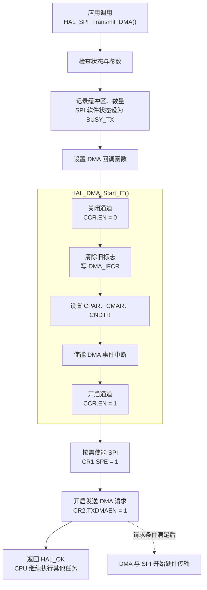
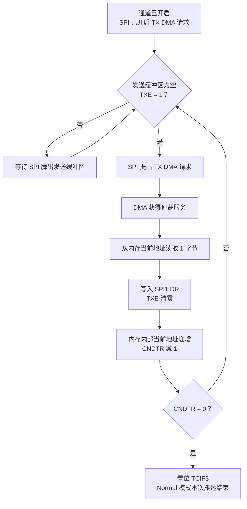
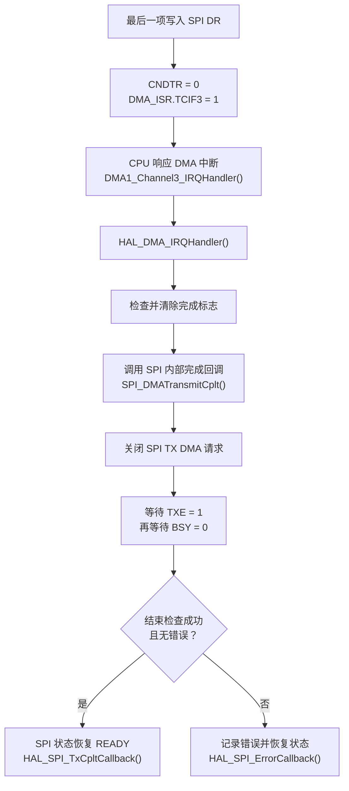

**user**: 阅读一遍当前笔记
[Timestamp: 2026/11/16 05:35:38]

**ai**: 我先通读这篇 DMA 笔记，了解内容和结构。
已通读 [[DMA-Direct Memory Access]]。

笔记以 **STM32F103 的 SPI DMA 发送**为主线，涵盖 DMA 基本概念、请求触发、通道与配置、Normal/Circular 模式、相关寄存器，以及 `HAL_SPI_Transmit_DMA()` 的执行流程。

目前正文停在 **6.1「为什么 DMA 完成后需要中断？」**，这一节尚未展开。我已了解现有内容，未修改笔记。
[Timestamp: 2026/11/16 05:35:38]

**user**: 第五个解释的是DMA的使用，但是解释的并不好，逻辑不清晰，细节不到位。我希望能讲解DMA的执行逻辑，需要结合寄存器进行讲解。输出在对话框，不要直接修改笔记
[Timestamp: 2026/11/16 05:55:38]

**ai**: 我会先核对 STM32F103 的参考手册和 HAL 源码，把第五节按“软件配置寄存器 → 硬件响应请求 → 传输完成”的顺序重新组织，内容只输出在对话中。
原第五节主要按 HAL 函数调用顺序展开，缺少寄存器变化与硬件动作之间的联系。重写时会重点讲清：DMA 如何知道搬到哪里、SPI 何时提出请求、每搬完一项哪些状态会变化，以及为什么 DMA 完成后还要等待 SPI 发完。
第五节需要把 **CPU 写入寄存器的配置过程**和 **DMA、SPI 随后自动执行的硬件过程**串起来。沿着一次具体传输展开，逻辑会更清楚。

下面以 **STM32F103C8T6、SPI1 主机、8 位数据、DMA Normal 模式、关闭 CRC** 为例：

```c
static uint8_t data[4] = {0x11, 0x22, 0x33, 0x44};

HAL_SPI_Transmit_DMA(&hspi1, data, 4);
```

我们要追踪的是：**这 4 个字节怎样从内存进入 SPI，并最终从 MOSI 发出去。**

**1．先确定：请求走哪个通道，数据搬到哪里**

STM32F103 的 `SPI1_TX` 请求固定连接到 **DMA1 Channel 3**，因此需要配置 `DMA1_Channel3`。这个连接由芯片硬件决定。[RM0008，DMA 请求映射](https://www.st.com/resource/en/reference_manual/rm0008-stm32f101xx-stm32f102xx-stm32f103xx-stm32f105xx-and-stm32f107xx-advanced-armbased-32bit-mcus-stmicroelectronics.pdf)

这里有两个独立的问题：

| 问题 | 由什么决定 |
|---|---|
| 谁通知 DMA 可以搬运？ | SPI1_TX 请求与 Channel 3 的硬件连接 |
| DMA 从哪里读、往哪里写？ | Channel 3 的地址寄存器和方向配置 |

所以，**把 `SPI1->DR` 的地址写进 DMA，并不会自动建立请求连接**；通道必须选对。

本例中，DMA 负责读取数组、写入 `SPI1->DR`；SPI 负责把写入的数据按位发送。

**2．CPU 先配置 DMA：地址、数量、搬运规则**

假设 DMA1、SPI1 的时钟及 SPI 引脚、通信参数已经初始化。相关时钟使能位分别是 `RCC_AHBENR.DMA1EN` 和 `RCC_APB2ENR.SPI1EN`。[STM32F103xB 寄存器定义](https://github.com/STMicroelectronics/cmsis-device-f1/blob/master/Include/stm32f103xb.h)

配置本次传输时，先让 Channel 3 的 `CCR.EN = 0`，再写入：

```c
// 示意：配置本次传输，不是完整驱动代码
DMA1_Channel3->CCR &= ~DMA_CCR_EN;

// 向清除寄存器写 1，清除 Channel 3 的旧标志
DMA1->IFCR = DMA_IFCR_CGIF3;

DMA1_Channel3->CPAR  = (uint32_t)&SPI1->DR;
DMA1_Channel3->CMAR  = (uint32_t)&data[0];
DMA1_Channel3->CNDTR = 4;
```

这三个寄存器分别回答：

| 寄存器 | 本例写入值 | 含义 |
|---|---|---|
| `CPAR` | `&SPI1->DR` | 外设一侧的地址 |
| `CMAR` | `&data[0]` | 内存一侧的起始地址 |
| `CNDTR` | `4` | 本次搬运 4 个数据项 |

注意，`CPAR`、`CMAR` 的名字表示**外设端、内存端**；哪一端是源、哪一端是目标，由 `CCR.DIR` 决定。本例为内存到外设，因此 `CMAR` 是源，`CPAR` 是目标。HAL 的 `DMA_SetConfig()` 正是按方向填入这些寄存器。[HAL DMA 源码](https://github.com/STMicroelectronics/stm32f1xx-hal-driver/blob/master/Src/stm32f1xx_hal_dma.c)

接下来，`CCR` 决定每次怎样搬：

| `CCR` 位域 | 本例配置 | 对硬件行为的影响 |
|---|---|---|
| `DIR` | `1` | 从内存端读取，写向外设端 |
| `MEM2MEM` | `0` | 使用外设请求驱动搬运 |
| `MINC` | `1` | 每搬完一项，内存内部当前地址递增 |
| `PINC` | `0` | 外设地址保持为 `SPI1->DR` |
| `MSIZE` | `00` | 每次读取 1 字节 |
| `PSIZE` | `00` | 每次向外设写入 1 字节 |
| `CIRC` | `0` | Normal 模式，完成指定数量后结束 |

本例两端都是 Byte，因此 `CNDTR = 4` 对应 4 字节。**`CNDTR` 记录的是数据项数量；数据项的宽度需要结合配置理解。** 通道开启后，不能直接改写传输数量来启动下一批。[ST LL DMA 定义与接口](https://github.com/STMicroelectronics/stm32f1xx-hal-driver/blob/master/Inc/stm32f1xx_ll_dma.h)

在 HAL 中，方向、宽度、递增和模式通常由初始化阶段的 `HAL_DMA_Init()` 设置；每次发送时，`HAL_DMA_Start_IT()` 再配置本次的地址和数量。

**3．打开 DMA 通道，再打开 SPI 的请求功能**

配置完成后，需要让两侧都进入工作状态：

```c
DMA1_Channel3->CCR |= DMA_CCR_EN;    // DMA 通道允许工作
SPI1->CR1 |= SPI_CR1_SPE;            // SPI 允许工作
SPI1->CR2 |= SPI_CR2_TXDMAEN;        // SPI 允许提出 TX DMA 请求
```

三个使能位各有职责：

| 使能位 | 控制什么 |
|---|---|
| `DMA_CCR3.EN` | DMA Channel 3 是否启用 |
| `SPI_CR1.SPE` | SPI 外设是否启用 |
| `SPI_CR2.TXDMAEN` | SPI 是否允许发出发送 DMA 请求 |

`EN = 1` 只是让 DMA 通道准备好。在本例的外设请求模式下，它还要等待 SPI 的请求。[ST LL SPI 接口](https://github.com/STMicroelectronics/stm32f1xx-hal-driver/blob/master/Inc/stm32f1xx_ll_spi.h)

`HAL_SPI_Transmit_DMA()` 会先启动 DMA，再按需使能 SPI，最后设置 `TXDMAEN`。返回 `HAL_OK` 表示启动成功；硬件此时可能已经开始传输，并不需要等待函数返回才工作。[HAL SPI 源码](https://github.com/STMicroelectronics/stm32f1xx-hal-driver/blob/master/Src/stm32f1xx_hal_spi.c)

**4．第一次搬运：SPI 提出请求，DMA 读取内存并写入 DR**

SPI 的 `SR.TXE` 表示**发送缓冲区是否为空**：

- `TXE = 1`：可以向发送缓冲区写入下一项。
- `TXE = 0`：发送缓冲区还有数据，暂时不能再写。

当发送缓冲区为空，并且 `TXDMAEN = 1` 时，SPI 提出 TX DMA 请求。DMA 获得仲裁服务后，执行第一次搬运：

1. 按内存内部当前地址，读取 `data[0]`，得到 `0x11`。
2. 按外设地址，把 `0x11` 写入 `SPI1->DR`。
3. 内存内部当前地址向后移动 1 字节。
4. `CNDTR` 从 `4` 减为 `3`。

写入 DR 会使发送缓冲区变为非空，`TXE` 被清零；请求通过硬件应答完成。**CPU 不需要执行这次读数组、写 DR 的操作。**[RM0008，DMA transactions 与 SPI communication using DMA](https://www.st.com/resource/en/reference_manual/rm0008-stm32f101xx-stm32f102xx-stm32f103xx-stm32f105xx-and-stm32f107xx-advanced-armbased-32bit-mcus-stmicroelectronics.pdf)

**5．后续搬运：由 SPI 腾出缓冲区的速度推动**

写入 DR 后，SPI 把发送缓冲区中的数据装入内部移位寄存器，再按 SCK 节拍逐位发送。

当发送缓冲区的数据进入移位寄存器后，发送缓冲区就空了，`TXE` 可以重新置 `1`。**此时上一字节可能仍在 MOSI 上发送。**

因此，DMA 可以在 SPI 发送上一字节期间，把下一字节提前填入发送缓冲区。这解释了为什么：

> **`TXE = 1` 表示能够接收下一项数据，不表示上一项已经在线路上发送完毕。**

SPI 再次提出请求，DMA 再搬一项，如此推进。[RM0008，SPI 发送时序](https://www.st.com/resource/en/reference_manual/rm0008-stm32f101xx-stm32f102xx-stm32f103xx-stm32f105xx-and-stm32f107xx-advanced-armbased-32bit-mcus-stmicroelectronics.pdf)

本例的数据变化可以这样追踪：

| 已完成的 DMA 搬运次数 | 本次读取位置 | 写入 DR 的数据 | 搬运后的 `CNDTR` |
|---|---|---|---|
| 1 | `&data[0]` | `0x11` | `3` |
| 2 | `&data[1]` | `0x22` | `2` |
| 3 | `&data[2]` | `0x33` | `1` |
| 4 | `&data[3]` | `0x44` | `0` |

这里递增的是 **DMA 内部维护的当前地址**。`CMAR` 保留配置时的起始地址，不会在调试窗口中依次变成 `&data[1]`、`&data[2]`。`CPAR` 也保留配置的基地址。[RM0008，DMA 地址与传输过程](https://www.st.com/resource/en/reference_manual/rm0008-stm32f101xx-stm32f102xx-stm32f103xx-stm32f105xx-and-stm32f107xx-advanced-armbased-32bit-mcus-stmicroelectronics.pdf)

**6．最后一项写入 DR：DMA 完成，SPI 继续发送**

第四次搬运完成后：

```c
DMA1_Channel3->CNDTR == 0
DMA1->ISR 中的 TCIF3 == 1
```

`TCIF3` 表示 Channel 3 的指定数量已经搬完。

在 Normal 模式下，此后 DMA 不再服务这批传输的请求。STM32F1 上，不能据此认为 `CCR.EN` 一定被硬件清零；重新配置下一批前，仍需软件关闭通道。[RM0008，Normal 模式](https://www.st.com/resource/en/reference_manual/rm0008-stm32f101xx-stm32f102xx-stm32f103xx-stm32f105xx-and-stm32f107xx-advanced-armbased-32bit-mcus-stmicroelectronics.pdf)

但此刻，`0x44` 只是已经写进 SPI。它可能还在发送缓冲区，也可能正在移位发送。

所以结束 SPI 发送需要继续检查：

```c
// 表达检查顺序，实际驱动还应处理超时
while ((SPI1->SR & SPI_SR_TXE) == 0) { }
while ((SPI1->SR & SPI_SR_BSY) != 0) { }
```

先等待发送缓冲区为空，再等待 SPI 不忙。**DMA 完成、TXE 置位、SPI 不忙，是三个不同的状态。** HAL 的结束检查也采用先等待 `TXE = 1`、再等待 `BSY = 0` 的顺序。[HAL SPI 结束检查](https://github.com/STMicroelectronics/stm32f1xx-hal-driver/blob/master/Src/stm32f1xx_hal_spi.c)

**7．CPU 如何知道完成：状态标志、中断和回调**

`TCIF3` 是硬件状态标志；是否通知 CPU，还取决于中断配置。

使用 HAL 中断路径时，需要使能 `CCR.TCIE`，并配置 NVIC 和中断入口，例如：

```c
void DMA1_Channel3_IRQHandler(void)
{
    HAL_DMA_IRQHandler(&hdma_spi1_tx);
}
```

完成事件发生后，CPU 进入该中断，`HAL_DMA_IRQHandler()` 检查标志及中断使能位，通过 `IFCR` 清除完成标志，并调用 DMA 句柄里的完成回调。这里的中断负责处理事件；前面每一项的数据搬运已经由硬件完成。[HAL DMA 中断处理源码](https://github.com/STMicroelectronics/stm32f1xx-hal-driver/blob/master/Src/stm32f1xx_hal_dma.c)

SPI HAL 安装的内部完成回调是 `SPI_DMATransmitCplt()`。在本例 Normal 模式且无错误的路径中，它会：

- 关闭 SPI 的 TX DMA 请求。
- 等待 `TXE = 1`、`BSY = 0`，确认 SPI 发完。
- 将 SPI 软件状态恢复为 `READY`。
- 调用用户的 `HAL_SPI_TxCpltCallback()`。

因此，**这个用户回调是在 HAL 检查 SPI 发送结束之后调用的**。若结束检查失败，则走错误回调。这一行为限定于这里讨论的 STM32F1 HAL Normal 模式。[HAL SPI 完成回调源码](https://github.com/STMicroelectronics/stm32f1xx-hal-driver/blob/master/Src/stm32f1xx_hal_spi.c)

调用发送函数时，HAL 保存的是缓冲区指针，没有复制整份数组；应用需要让 `data` 保持有效，并在传输完成前避免覆盖其中的数据。
[Timestamp: 2026/11/16 05:55:38]

**user**: 写的很清晰了，但是缺少HAL函数部分，与实际应用有一些差距，结合HAL函数对第五节进行重写，画流程图按照mermaid格式。
[Timestamp: 2026/11/16 08:42:25]

**ai**: 我会保留寄存器层面的执行逻辑，把 HAL 初始化、启动、硬件传输和中断回调串起来，并用 Mermaid 画流程图。重写内容仍只放在对话中。
我会使用 obsidian-markdown 技能检查 Mermaid 和笔记格式。
这版会区分“初始化时配置搬运规则”和“每次发送时设置地址、数量并启动”，再接上 DMA 完成后的 HAL 回调链。示例按 CubeMX 工程组织，便于把笔记中的寄存器行为对应到实际代码。
## 五、结合 HAL 与寄存器理解 SPI DMA 的完整执行过程

以 **STM32F103C8T6、SPI1 主机、8 位数据、DMA Normal 模式、关闭 CRC** 为例，发送下面的数组：

```c
static uint8_t data[4] = {0x11, 0x22, 0x33, 0x44};

HAL_SPI_Transmit_DMA(&hspi1, data, 4);
```

要理解这次发送，需要依次看清：

**初始化怎样确定搬运规则 → HAL 怎样启动本次传输 → DMA 怎样响应 SPI 请求 → HAL 怎样处理完成事件。**

### 5.1 初始化：配置 SPI、DMA，并建立句柄关联

在 CubeMX 工程中，通常可以看到：

```c
MX_GPIO_Init();
MX_DMA_Init();
MX_SPI1_Init();
```

这些 `MX_...` 函数是 CubeMX 生成的工程初始化函数，内部再调用 HAL 函数或宏。

其中，DMA 时钟必须在访问 DMA 寄存器之前开启。相关配置通常分布在 `MX_DMA_Init()` 和 `HAL_SPI_MspInit()` 中。[ST HAL 使用说明](https://www.st.com/resource/en/user_manual/um1850-description-of-stm32f1-hal-and-lowlayer-drivers-stmicroelectronics.pdf)

**① 开启 DMA 时钟，配置 DMA 中断**

`MX_DMA_Init()` 中的相关内容通常类似：

```c
__HAL_RCC_DMA1_CLK_ENABLE();

HAL_NVIC_SetPriority(DMA1_Channel3_IRQn, 1, 0);
HAL_NVIC_EnableIRQ(DMA1_Channel3_IRQn);
```

本例使用 **DMA1 Channel 3**，因为 STM32F103 的 `SPI1_TX` 请求固定连接到该通道。中断优先级数值只是示例，应结合工程设置。[RM0008，DMA 请求映射](https://www.st.com/resource/en/reference_manual/rm0008-stm32f101xx-stm32f102xx-stm32f103xx-stm32f105xx-and-stm32f107xx-advanced-armbased-32bit-mcus-stmicroelectronics.pdf)

**② 配置 DMA 的搬运规则**

`HAL_SPI_Init(&hspi1)` 首次初始化 SPI 时，会调用底层初始化函数 `HAL_SPI_MspInit()`。其中除了 SPI 时钟、GPIO 配置，还可以包含下面的 DMA 配置：

```c
// HAL_SPI_MspInit() 中 SPI1 分支的 DMA 相关部分
hdma_spi1_tx.Instance = DMA1_Channel3;
hdma_spi1_tx.Init.Direction = DMA_MEMORY_TO_PERIPH;
hdma_spi1_tx.Init.PeriphInc = DMA_PINC_DISABLE;
hdma_spi1_tx.Init.MemInc = DMA_MINC_ENABLE;
hdma_spi1_tx.Init.PeriphDataAlignment = DMA_PDATAALIGN_BYTE;
hdma_spi1_tx.Init.MemDataAlignment = DMA_MDATAALIGN_BYTE;
hdma_spi1_tx.Init.Mode = DMA_NORMAL;
hdma_spi1_tx.Init.Priority = DMA_PRIORITY_MEDIUM;

if (HAL_DMA_Init(&hdma_spi1_tx) != HAL_OK)
{
    Error_Handler();
}

__HAL_LINKDMA(hspi, hdmatx, hdma_spi1_tx);
```

这里的 `hspi` 是 `HAL_SPI_MspInit()` 的参数，指向正在初始化的 SPI 句柄。

`hdma_spi1_tx.Init` 是内存中的配置结构体。调用 `HAL_DMA_Init()`，才会把相应参数写入 DMA 通道的 `CCR` 寄存器。[HAL DMA 初始化实现](https://github.com/STMicroelectronics/stm32f1xx-hal-driver/blob/master/Src/stm32f1xx_hal_dma.c)

| HAL 配置 | 对应 `CCR` 位域 | 本例作用 |
|---|---|---|
| `DMA_MEMORY_TO_PERIPH` | `DIR = 1`、使用外设请求模式 | 从内存搬向外设 |
| `DMA_PINC_DISABLE` | `PINC = 0` | 外设地址固定 |
| `DMA_MINC_ENABLE` | `MINC = 1` | 内存当前地址递增 |
| `DMA_PDATAALIGN_BYTE` | `PSIZE = 00` | 每次向外设写入 1 字节 |
| `DMA_MDATAALIGN_BYTE` | `MSIZE = 00` | 每次从内存读取 1 字节 |
| `DMA_NORMAL` | `CIRC = 0` | 完成指定数量后结束 |
| `DMA_PRIORITY_MEDIUM` | `PL = 01` | 设置 DMA 通道仲裁优先级 |

**初始化阶段主要确定“怎样搬”，本次数据的地址和数量在启动传输时设置。**[ST DMA 配置定义](https://github.com/STMicroelectronics/stm32f1xx-hal-driver/blob/master/Inc/stm32f1xx_ll_dma.h)

**③ 建立 SPI 句柄与 DMA 句柄之间的关联**

```c
__HAL_LINKDMA(hspi, hdmatx, hdma_spi1_tx);
```

可以理解为执行了：

```c
hspi->hdmatx = &hdma_spi1_tx;
hdma_spi1_tx.Parent = hspi;
```

这样，SPI HAL 能找到发送 DMA，DMA 完成后也能找到所属 SPI。

**这一步建立的是软件指针关系。** SPI1_TX 与 Channel 3 的请求连接已经由芯片硬件确定。[`__HAL_LINKDMA` 宏定义](https://github.com/STMicroelectronics/stm32f1xx-hal-driver/blob/master/Inc/stm32f1xx_hal_def.h)

### 5.2 发起发送：HAL 先记录本次任务

应用调用：

```c
HAL_StatusTypeDef status;

status = HAL_SPI_Transmit_DMA(&hspi1, data, 4);

if (status != HAL_OK)
{
    // 本次启动未成功，进入应用自己的错误处理
    Error_Handler();
}
```

其中：

- `&hspi1`：使用哪一个 SPI。
- `data`：发送缓冲区的起始地址。
- `4`：发送的数据项数量；本例每项为 8 位。

这是非阻塞接口，启动后 CPU 可以继续执行其他任务。`HAL_OK` 表示启动成功，不能用来判断发送已经完成。[HAL SPI API 说明](https://www.st.com/resource/en/user_manual/um1850-description-of-stm32f1-hal-and-lowlayer-drivers-stmicroelectronics.pdf)

HAL 首先检查 SPI 是否处于可用状态，以及指针、数量是否有效，然后记录本次发送信息：

| SPI 句柄字段 | 本例含义 |
|---|---|
| `State` | 标记为 `BUSY_TX` |
| `pTxBuffPtr` | 保存 `data` 的地址 |
| `TxXferSize` | 保存本次总数量 `4` |
| `TxXferCount` | 初始化为 `4` |

这些字段位于 RAM 中，属于 HAL 的软件管理信息。**硬件实际剩余搬运数量要看 DMA 的 `CNDTR`；不能把软件字段当作 DMA 寄存器。**[SPI 句柄定义](https://github.com/STMicroelectronics/stm32f1xx-hal-driver/blob/master/Inc/stm32f1xx_hal_spi.h)

HAL 还会设置 DMA 的完成、半完成和错误处理函数，为后续中断处理建立入口。[HAL SPI 启动实现](https://github.com/STMicroelectronics/stm32f1xx-hal-driver/blob/master/Src/stm32f1xx_hal_spi.c)

### 5.3 启动 DMA：把本次地址和数量写入寄存器

接下来，SPI HAL 内部调用的核心接口相当于：

```c
HAL_DMA_Start_IT(
    hspi1.hdmatx,
    (uint32_t)data,
    (uint32_t)&SPI1->DR,
    4
);
```

应用使用 `HAL_SPI_Transmit_DMA()` 时，这一步由 SPI HAL 完成。

`HAL_DMA_Start_IT()` 在 DMA 软件状态允许启动时，关闭通道、清除旧标志、设置地址与数量、使能所需中断，再开启通道。[HAL DMA 启动实现](https://github.com/STMicroelectronics/stm32f1xx-hal-driver/blob/master/Src/stm32f1xx_hal_dma.c)

对应到本例：

| 操作 | 寄存器变化 | 原因 |
|---|---|---|
| 关闭通道 | `CCR.EN = 0` | 允许配置本次传输 |
| 清除旧标志 | 向 `IFCR` 对应位写 `1` | 清除上次遗留事件 |
| 设置目标 | `CPAR = &SPI1->DR` | 每次写入 SPI 数据寄存器 |
| 设置源 | `CMAR = &data[0]` | 从数组起始位置读取 |
| 设置数量 | `CNDTR = 4` | 搬运 4 个数据项 |
| 配置事件中断 | 设置 `TCIE`、`TEIE`，按需设置 `HTIE` | 处理完成、错误、半完成 |
| 开启通道 | `CCR.EN = 1` | 允许通道响应请求 |

这些使能位和清除标志宏最终都作用于 DMA 寄存器。[DMA 宏与寄存器操作](https://github.com/STMicroelectronics/stm32f1xx-hal-driver/blob/master/Inc/stm32f1xx_hal_dma.h)

**此时 DMA 已经准备好，但还需要 SPI 提供请求。**

### 5.4 打开 SPI 请求：让硬件传输开始推进

DMA 启动成功后，SPI HAL 按需设置：

```c
// SPI 未开启时，使能 SPI
__HAL_SPI_ENABLE(&hspi1);

// 允许 SPI 产生发送 DMA 请求
SET_BIT(hspi1.Instance->CR2, SPI_CR2_TXDMAEN);
```

对应两个寄存器位：

| 寄存器位 | 作用 |
|---|---|
| `SPI_CR1.SPE` | 使能 SPI |
| `SPI_CR2.TXDMAEN` | 允许 SPI 发出 TX DMA 请求 |

`HAL_SPI_Transmit_DMA()` 随后返回。硬件可以在 `TXDMAEN` 开启、请求条件满足后立即工作，无需等待函数返回。[HAL SPI 启动顺序](https://github.com/STMicroelectronics/stm32f1xx-hal-driver/blob/master/Src/stm32f1xx_hal_spi.c)

软件启动过程如下，图中省略错误处理和 CRC 等分支：



### 5.5 硬件执行：SPI 提请求，DMA 搬一项

进入硬件传输阶段后，关键是 `SPI_SR.TXE`：

- `TXE = 1`：发送缓冲区为空，可以接收下一项。
- `TXE = 0`：发送缓冲区非空，暂时不能再写。

`TXDMAEN = 1` 允许 SPI 根据发送缓冲区的状态提出 DMA 请求。[SPI 请求使能与状态定义](https://github.com/STMicroelectronics/stm32f1xx-hal-driver/blob/master/Inc/stm32f1xx_ll_spi.h)

以第一次搬运为例，DMA 响应请求并获得总线访问后：

1. 从内存当前地址读取 `data[0]`，得到 `0x11`。
2. 将 `0x11` 写入 `SPI1->DR`。
3. 内存内部当前地址递增 1 字节。
4. `CNDTR` 从 `4` 减为 `3`。

写入 DR 后，发送缓冲区非空，`TXE` 清零。SPI 随后把缓冲区数据装入移位寄存器，并按 SCK 节拍发送；缓冲区腾空后，`TXE` 再次置位，推动下一次请求。[RM0008，DMA 与 SPI 发送过程](https://www.st.com/resource/en/reference_manual/rm0008-stm32f101xx-stm32f102xx-stm32f103xx-stm32f105xx-and-stm32f107xx-advanced-armbased-32bit-mcus-stmicroelectronics.pdf)



这个流程中没有“每搬一字节就调用一次 HAL 函数”。HAL 已经完成配置，后续由硬件反复响应请求。

| 搬运次数 | 读取数据 | 写入目标 | 搬运后的 `CNDTR` |
|---|---|---|---|
| 1 | `data[0] = 0x11` | `SPI1->DR` | `3` |
| 2 | `data[1] = 0x22` | `SPI1->DR` | `2` |
| 3 | `data[2] = 0x33` | `SPI1->DR` | `1` |
| 4 | `data[3] = 0x44` | `SPI1->DR` | `0` |

这里递增的是 DMA **内部当前地址**，配置的 `CMAR` 仍保留起始地址。

同时，**`TXE = 1` 不代表上一字节已经发完**：上一字节可以仍在移位寄存器中发送，而 DMA 已经向腾空的发送缓冲区填入下一字节。[RM0008，DMA 地址与 SPI 缓冲机制](https://www.st.com/resource/en/reference_manual/rm0008-stm32f101xx-stm32f102xx-stm32f103xx-stm32f105xx-and-stm32f107xx-advanced-armbased-32bit-mcus-stmicroelectronics.pdf)

### 5.6 完成处理：从 DMA 中断进入 SPI HAL 回调

最后一项写入 DR 后，`CNDTR = 0`，DMA 将 `ISR.TCIF3` 置位。满足中断使能条件时，CPU 进入：

```c
void DMA1_Channel3_IRQHandler(void)
{
    HAL_DMA_IRQHandler(&hdma_spi1_tx);
}
```

**这个中断入口必须调用对应 DMA 句柄的 HAL 处理函数，完成事件才能沿 HAL 回调链继续处理。**[HAL DMA 中断用法](https://www.st.com/resource/en/user_manual/um1850-description-of-stm32f1-hal-and-lowlayer-drivers-stmicroelectronics.pdf)

`HAL_DMA_IRQHandler()` 读取状态、通过 `IFCR` 清除完成标志，并调用此前安装的完成回调。

对于 SPI TX，这个内部回调是：

```c
SPI_DMATransmitCplt()
```

该函数通过 DMA 句柄的 `Parent` 找回 SPI 句柄。在本例 Normal 模式下，它关闭 TX DMA 请求，并检查：

1. `TXE = 1`：发送缓冲区已经腾空。
2. `BSY = 0`：SPI 已经完成线路上的发送。

检查成功后，恢复 SPI 软件状态，并通知用户。[HAL SPI 完成处理实现](https://github.com/STMicroelectronics/stm32f1xx-hal-driver/blob/master/Src/stm32f1xx_hal_spi.c)



因此，需要区分两个时刻：

| 时刻 | 表示什么 |
|---|---|
| DMA 的 `TCIF3` 置位 | 最后一项已经搬进 SPI |
| 本例的 `HAL_SPI_TxCpltCallback()` 被调用 | HAL 已确认 SPI 正常发送结束 |

这里描述的是 **STM32F1 HAL、Normal 模式**的处理路径。

### 5.7 应用使用回调获知结果

采用默认的弱函数回调机制时，应用可以实现：

```c
static volatile uint8_t spi1_tx_done = 0;
static volatile uint8_t spi1_tx_failed = 0;

void HAL_SPI_TxCpltCallback(SPI_HandleTypeDef *hspi)
{
    if (hspi->Instance == SPI1)
    {
        spi1_tx_done = 1;
    }
}

void HAL_SPI_ErrorCallback(SPI_HandleTypeDef *hspi)
{
    if (hspi->Instance == SPI1)
    {
        spi1_tx_failed = 1;
    }
}
```

发送前先清除应用标志，再发起本次任务：

```c
spi1_tx_done = 0;
spi1_tx_failed = 0;

HAL_StatusTypeDef status =
    HAL_SPI_Transmit_DMA(&hspi1, data, 4);

if (status != HAL_OK)
{
    // 启动失败，不能等待本次发送的完成回调
    Error_Handler();
}

// CPU 继续处理其他任务
// 后续根据 spi1_tx_done / spi1_tx_failed 处理结果
```

这些回调由中断处理路径调用，适合设置标志，把较长的业务处理留给主循环或任务。若工程启用了动态回调注册，应使用对应的注册接口。[HAL SPI 回调机制](https://github.com/STMicroelectronics/stm32f1xx-hal-driver/blob/master/Inc/stm32f1xx_hal_spi.h)

发送缓冲区必须在整个传输期间保持有效；在应用获知完成之前，不要覆盖其中的数据。HAL 保存缓冲区地址后，DMA 会在后续请求到来时逐项读取它。
[Timestamp: 2026/11/16 08:42:25]

**user**: https://chatgpt.com/share/6afc58e6-4a40-83e8-9c29-ec4b07eb94cd是否能看到对话内容
[Timestamp: 2026/11/17 06:39:38]

**ai**: 我尝试打开这个分享链接，确认能否读取其中的对话。
目前**看不到链接中的对话正文**。我尝试打开后，读取工具返回了 `Cache miss`，无法判断是链接本身还是访问限制导致的。

你可以把相关对话直接粘贴到这里，或上传截图，我就能接着阅读。
[Timestamp: 2026/11/17 06:39:38]

**user**: 是否可以看到对话内容https://chatgpt.com/share/6afc58e6-4a40-83e8-9c29-ec4b07eb94cd
[Timestamp: 2026/11/17 06:40:35]

**ai**: 我再尝试读取一次这个分享链接。
目前仍然**无法看到对话内容**。重新读取返回 `Cache miss`，换用直接访问也未能连接。

请将需要我阅读的对话粘贴到这里，或上传截图。
[Timestamp: 2026/11/17 06:40:35]

**user**: D:\Obsidian_repository\Attachments\重新解释DMA中断机制.html我将内容存为了html文件

DMA对话.md是我复制的内容但是缺少图片，我简单进行了复制，但也只做了一部分，有些内容无法进行复制，比如·一些可交互内容，比如DMA对话中所展示的三个阶段，在html中只展示了一个阶段。这里如果可以就不要存为SVG图片而是以mermaid进行展示。其他图片要存为SVG放在D:\Obsidian_repository\Attachments中，接下来将剩余的对话内容（6.2.3 DMA 中断请求如何传递给 CPU？以及之后）写入笔记当中。注意标题格式、代码格式
[Timestamp: 2026/11/17 07:07:50]

**ai**: 我先核对 HTML 和已复制笔记中 6.2.3 前后的内容，查看剩余对话、图片和交互内容的保存情况，再确定续写与图示转换方案。
主笔记目前正好停在空的“6.2.3”，HTML 和复制稿则包含后续到 6.8 的内容，可以从这里接续。接下来我会核对静态插图，并检查“三个阶段”还保留了哪些状态说明，以便用 Mermaid 完整呈现。
我会从 6.2.3 开始补入主笔记，将三阶段、调用链和生命周期整理成 Mermaid，并提取其余 8 张 SVG 插图。完成后检查标题、代码块和图片引用。
6.2.3 到 6.8 已补入，8 张 SVG 也已保存并嵌入。原网页卡片已整理为 3 个 Mermaid 图：传输三阶段、完整调用链和四阶段生命周期。现在检查已有内容是否保持原样，以及图片引用和代码格式是否完整。
内容与格式检查已通过：原有 6.2.3 之前的内容保持原样，续写覆盖至 6.8，代码围栏闭合，8 个 SVG 均可解析且引用有效。浏览器预览未能生成，因此尚未实际确认 Obsidian 中的渲染效果。
已续写 [[DMA-Direct Memory Access]] 的 **6.2.3–6.8**，加入 **3 个 Mermaid 图**，统一标题与代码格式。

新增 SVG 均位于 `Attachments/`：

- `DMA-中断传递.svg`、`DMA-SPI内部结构.svg`
- `DMA-外设完成处理.svg`、`DMA-回调注册.svg`
- `DMA-句柄关联.svg`、`DMA-SPI完成回调.svg`
- `DMA-中断上下文.svg`、`DMA-Request与Interrupt.svg`

内容、代码围栏及图片引用检查通过；尚未在 Obsidian 内验证渲染效果。
[Timestamp: 2026/11/17 07:07:50]